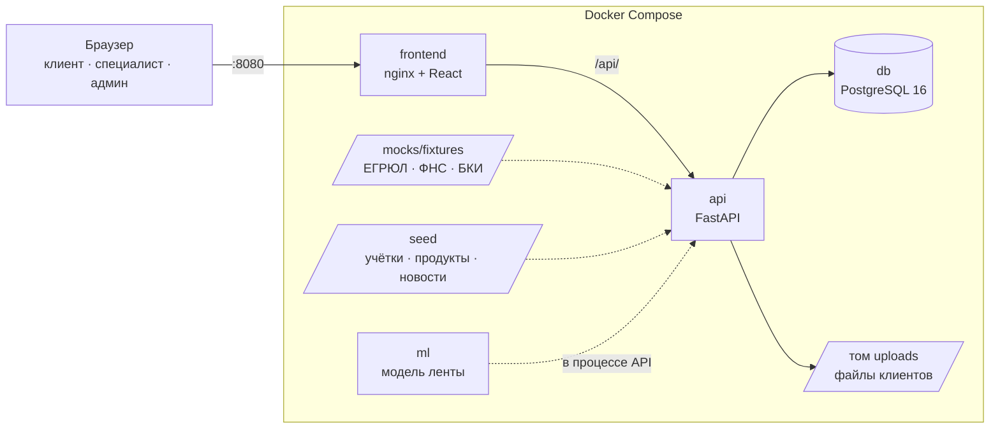

# Умный кредитный кабинет предпринимателя

Прототип для кейса Альфа-Банка. Предприниматель в одном веб-кабинете подбирает кредит, подаёт заявку и получает решение, подписывает договор и видит выдачу. Банк в том же продукте проверяет компанию, считает скоринг, принимает автоматическое или ручное решение. Персональная лента сообщает о каждом шаге заявки и подбирает новости под бизнес клиента с объяснением «Почему вы это видите».

Все данные синтетические. Внешние сервисы (ЕГРЮЛ/ЕГРИП, ФНС, БКИ, подпись, выдача) смоделированы локально. Платных сервисов нет, доступа к системам банка нет. Email, SMS и звонки не участвуют: всё происходит внутри кабинета.

## Что можно проверить

- **Клиент:** подбор продукта по цели, сумме и сроку → анкета с данными из реестра по ИНН → мгновенное решение (одобрение, другие условия, отказ с понятной причиной, запрос документов) → загрузка документов → подписание кодом → выдача и график платежей.
- **Кредитный специалист:** очередь заявок, карточка с ответами источников, скорингом F1–F6 и трассой правил R1–R10, просмотр документов клиента, решение: одобрить, предложить другие условия, запросить документы, отказать.
- **Администратор:** журнал всех действий (входы, заявки, статусы, файлы, решения) и сброс демо-данных перед показом; кабинет банка — только для чтения.
- **Лента:** события по заявкам вместо уведомлений и новости, отобранные правилами и упорядоченные моделью ML. У Пекарни, Ковалёва и Мельниковой лента разная.

## Запуск

Нужны Docker с Compose v2 (Docker Desktop или Docker Engine), около 4 ГБ свободной памяти и свободные порты 8080 и 8000. Для первой сборки нужен интернет: скачиваются образы и зависимости по lock-файлам.

```bash
git clone https://github.com/jewweller/alfa-credit-cabinet.git
cd alfa-credit-cabinet
cp .env.example .env
docker compose up --build
```

| Что | Адрес |
| --- | --- |
| Кабинет | http://localhost:8080 |
| Swagger (API) | http://127.0.0.1:8000/api/docs |
| Готовность API | http://127.0.0.1:8000/ready |

При старте API сам применяет миграции и загружает демо-учётки. Первые секунды, пока API не готов, кабинет может показывать ошибку загрузки — обновите страницу.

Остановить: `Ctrl+C`, затем `docker compose down`. Удалить и данные: `docker compose down -v`.

## Демо-учётки

Пароль у всех — `Demo2026!`. На экране входа учётки перечислены, нажатие подставляет логин.

| Логин | Кто | Что покажет |
| --- | --- | --- |
| `bakery@demo.local` | ООО «Пекарня Север» | одобрение, подпись, выдача |
| `kovalev@demo.local` | ИП Ковалёв А.С. | другие условия |
| `stroy@demo.local` | ООО «СтройРесурс» | отказ: компания ликвидирована |
| `vektor@demo.local` | ООО «Вектор» | отказ: просрочка в БКИ |
| `melnikova@demo.local` | ИП Мельникова Е.В. | запрос документов → решение специалиста |
| `mirage@demo.local` | ООО «Мираж» | ручное рассмотрение: низкий грейд |
| `sboy@demo.local` | ООО «Сбой-Тест» | ручное рассмотрение: недоступен источник БКИ |
| `underwriter@demo.local` | кредитный специалист | очередь, карточка, решение |
| `admin@demo.local` | администратор | журнал действий, сброс демо |

## Сценарий проверки за 10 минут

1. **Сброс.** Войти как `admin@demo.local` → «Сбросить данные» → «Да, сбросить».
2. **Одобрение.** `bakery@demo.local` → «Подобрать кредит» → «Оборотные средства», 3 000 000 ₽, 12 мес → «Экспресс-оборот» → выручка 24 000 000 ₽, платежи 150 000 ₽/мес, согласие на БКИ → «Отправить в банк». Ожидается «Заявка одобрена». «Принять предложение» → «Получить код» → ввести код с экрана → «Деньги зачислены» и график платежей.
3. **Другие условия.** `kovalev@demo.local`: 2 000 000 ₽ на 12 мес, выручка 6 000 000 ₽, платежи 60 000 ₽ → «Предлагаем другие условия»: 24 мес, платёж 101 791,61 ₽.
4. **Отказ.** `stroy@demo.local`: 2 000 000 ₽ на 12 мес, выручка 20 000 000 ₽ → «Банк отказал»: компания не действует по данным реестра.
5. **Документы и специалист.** `melnikova@demo.local`: 1 500 000 ₽ на 12 мес, выручка 12 000 000 ₽, платежи 0 → «Банку нужны документы» → загрузить `seed/demo-files/declaration.pdf` → «Отправить в банк». Затем `underwriter@demo.local` → очередь → карточка: источники, скоринг, правила, документ → «Взять в работу» → «Одобрить» → «Принять решение». Клиент видит «Заявка одобрена».
6. **Лента.** У Пекарни, Ковалёва и Мельниковой открыть «Вся лента»: события по своей заявке, новости своей отрасли и этапа, у каждой — «Почему вы это видите».
7. **Журнал.** `admin@demo.local`: все действия выше в журнале, у заявки — свой журнал в карточке.

Подробно, с ожидаемыми результатами по каждому шагу и остальными учётками: [docs/test-scenarios.md](docs/test-scenarios.md).

Через API — коллекция с проверками (42 запроса, 62 проверки), из корня репозитория:

```bash
npx newman run docs/api/collection.postman.json
```

## Архитектура



- **frontend** — React 19 + TypeScript + Vite, статика в nginx; nginx проксирует `/api/`.
- **api** — FastAPI, SQLAlchemy, Alembic. Заявка проходит конвейер синхронно: обогащение из источников с таймаутами и повторами → скоринг F1–F6 → правила R1–R10 → решение. Статусы меняются только по разрешённым переходам, каждый переход пишется в историю, ленту и журнал в одной транзакции.
- **db** — PostgreSQL 16, единственное хранилище состояния.
- **ml** — логистическая регрессия упорядочивает новости, уже отобранные правилами; при сбое модели — порядок по правилам. Кредитных решений модель не принимает.

Подробнее: [архитектура backend](docs/architecture.md) · [архитектура frontend](docs/frontend.md) · [модель данных и статусы](docs/data-model.md).

## Настройки

Все настройки — переменные окружения в `.env` (шаблон — `.env.example`, `.env` не коммитится). Для локальной проверки значения по умолчанию подходят.

| Переменная | По умолчанию | Что делает |
| --- | --- | --- |
| `POSTGRES_DB`, `POSTGRES_USER`, `POSTGRES_PASSWORD` | `alfa_credit`, `alfa`, `change-me-local-demo` | БД; на общем стенде задайте свой пароль |
| `JWT_SECRET` | демо-строка | подпись токенов входа, не короче 32 символов; на общем стенде — своя случайная |
| `SEED_DEMO_DATA` | `true` | загрузить демо-учётки, компании и продукты |
| `DEMO_MODE` | `true` | разрешить администратору сброс демо-данных |
| `ML_RANKING_ENABLED` | `true` | порядок новостей задаёт модель; `false` — всегда правила |
| `API_PORT`, `WEB_PORT` | `8000`, `8080` | порты на этом компьютере (только `127.0.0.1`) |
| `VITE_API_MODE` | `real` | `real` — всё в API; `mocks` — фронт целиком на моках в браузере, без бэка |
| `VITE_DEMO_MODE` | `true` | подсказка с демо-учётками на экране входа |

Полный список с назначением — [backend/README.md](backend/README.md#переменные-окружения). После смены `VITE_*` нужно пересобрать: `docker compose up --build`.

## Документация

| Документ | Что в нём |
| --- | --- |
| [docs/api/README.md](docs/api/README.md) | руководство по API: роли, ошибки, путь заявки, примеры |
| [docs/api/openapi.json](docs/api/openapi.json) | контракт OpenAPI; Swagger — `/api/docs` |
| [docs/api/collection.postman.json](docs/api/collection.postman.json) | коллекция запросов с проверками (Postman, Newman) |
| [docs/architecture.md](docs/architecture.md) | архитектура backend, конвейер заявки, диаграмма статусов, безопасность |
| [docs/frontend.md](docs/frontend.md) | экраны, слои, режимы данных frontend |
| [docs/data-model.md](docs/data-model.md) | таблицы, связи, статусы, миграции |
| [docs/test-scenarios.md](docs/test-scenarios.md) | пошаговые сценарии проверки с ожидаемым результатом |
| [docs/ml-experiment.md](docs/ml-experiment.md), [ml/DATA_CARD.md](ml/DATA_CARD.md) | модель ленты: данные, обучение, метрики, ограничения |
| [docs/plan.md](docs/plan.md) | план: границы MVP, кредитный процесс, скоринг, правила, экраны |
| [docs/analyst-questions.md](docs/analyst-questions.md) | допущения и решения, принятые командой |
| [seed/README.md](seed/README.md) | демо-данные и учётки |
| [THIRD_PARTY_NOTICES.md](THIRD_PARTY_NOTICES.md) | сторонние компоненты, лицензии, смоделированные интеграции |

## Разработка и тесты

```bash
# backend: ~700 тестов (правила, скоринг, API, контракт, модель ленты), линтер, контракт
cd backend && uv sync --frozen && uv run --frozen pytest -q
uv run --frozen ruff check . ../ml && uv run --frozen python -m app.openapi --check

# frontend: без бэка, всё на моках в браузере — http://localhost:5173
cd frontend && npm ci && npm run dev
npm run build   # проверка слоёв, типов, сборка
```

Проверки бэка запускаются в GitHub Actions на PR с изменениями в `backend/`, `ml/`, `docs/api/`, `seed/` (`.github/workflows/backend.yml`).

## Допущения и ограничения

- Логика решения упрощена и описана явно: веса скоринга и пороги правил — в `backend/app/scoring/config.yaml`, правила — в [плане](docs/plan.md#7-скоринг-и-кредитное-решение).
- Подписание — 6-значный код на экране вместо SMS; выдача — смена статуса и график, деньги не перечисляются.
- Ответы ЕГРЮЛ/ЕГРИП, ФНС и БКИ — синтетические фикстуры по 8 тестовым ИНН.
- Модель ленты обучена на синтетических кликах и восстанавливает гипотезы команды, а не поведение реальных клиентов.
- Решения, принятые без подтверждения аналитика, перечислены в [docs/analyst-questions.md](docs/analyst-questions.md).
