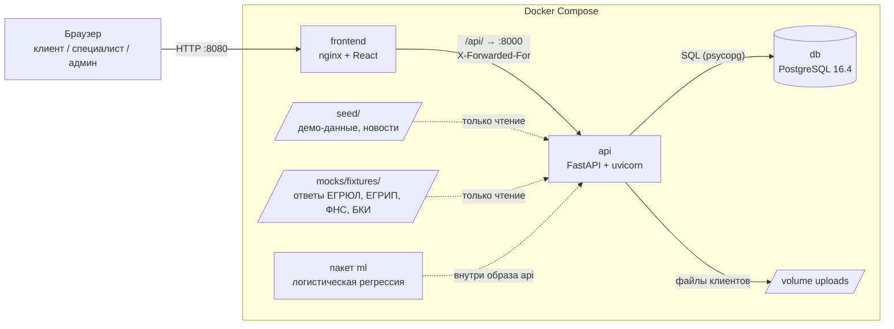
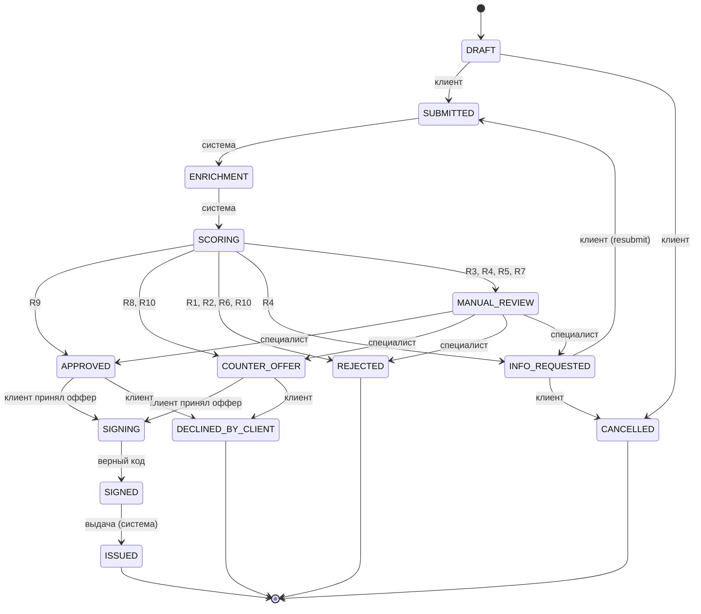
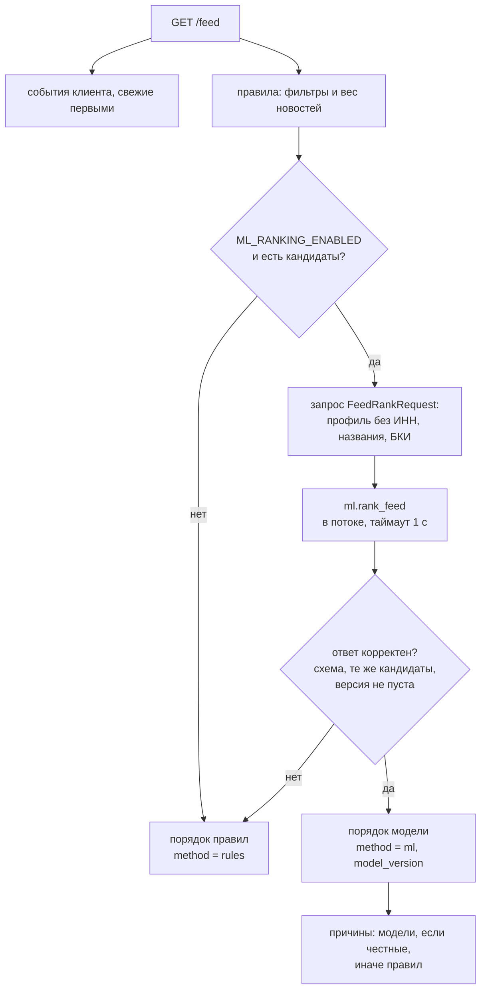

# Архитектура backend

Описана работающая реализация на 25.10.2026 (`main`). Чего в системе нет, перечислено в
разделе 11: оно не подразумевается. Схема БД — [data-model.md](data-model.md), API —
[api/README.md](api/README.md), решения, принятые без аналитика, —
[analyst-questions.md](analyst-questions.md).

## 1. Состав системы



| Компонент | Что это | Ответственность |
| --- | --- | --- |
| `frontend` | nginx со статикой React | отдаёт интерфейс, проксирует `/api/` в `api`, перезаписывает `X-Forwarded-For` адресом клиента |
| `api` | FastAPI, один процесс uvicorn | весь бизнес-код: авторизация, заявки, обогащение, скоринг, решение, документы, подпись и выдача, кабинет банка, лента, журнал |
| `db` | PostgreSQL 16.4 | единственное хранилище состояния; том `db-data` |
| том `uploads` | каталог `/uploads` в `api` | файлы клиентов; на диске имя — UUID, исходное имя только в БД |
| `seed/` | JSON, монтируется только для чтения | учётки, компании, продукты (`seed.py`), новости ленты (`seed/news.json`) |
| `mocks/fixtures/` | JSON, монтируется только для чтения | ответы внешних источников для 8 демо-ИНН |
| пакет `ml` | Python-пакет, копируется в образ `api` | ранжирование новостей ленты; вызывается в процессе API |

Фронтенд в режиме `mixed` ходит в этот API за реализованными операциями, остальное отвечают его
моки; режимы описаны в `frontend/README.md`.

## 2. Устройство приложения

Один процесс, синхронный код (`def`-эндпоинты, `sqlalchemy.orm.Session`): FastAPI выполняет их в
пуле потоков. Слои сверху вниз:

| Слой | Модули `backend/app/` | Что делает |
| --- | --- | --- |
| HTTP | `main.py`, `api/v1/router.py`, `api/deps.py`, `api/errors.py` | маршруты, проверка роли, единый формат ошибок `{code, message, field?}`, запоминание IP клиента для журнала |
| Контракт | `schemas/`, `openapi.py` | Pydantic-схемы запросов и ответов; `docs/api/openapi.json` генерируется из кода |
| Сервисы | `services/` | сценарии: `applications`, `pipeline`, `offers`, `documents`, `signing`, `schedule`, `bank`, `feed`, `audit`, `admin`, `products`, `companies`, `readiness`, `status` |
| Домен | `domain/` | машина состояний (`state_machine.py`), аннуитет (`loan_math.py`), проверка ИНН, формула и тексты ленты (`feed_ranking.py`, `feed_events.py`) |
| Движки | `scoring/`, `decision/` | скоринг F1–F6 и правила R1–R10; все пороги — в `scoring/config.yaml` (версия `1.0.0`) |
| Источники | `integrations/` | интерфейс `SourceClient`; реализация `FixtureSourceClient` читает JSON из `mocks/fixtures/` |
| Данные | `db/models.py`, `db/session.py`, `storage.py`, `alembic/` | модели SQLAlchemy, сессия на запрос, локальное хранилище файлов, миграции |

Конфигурация — только переменные окружения (`config.py`, `pydantic-settings`); таблица — в
[backend/README.md](../backend/README.md).

## 3. Путь запроса

1. nginx принимает запрос и передаёт его в `api` с адресом клиента в `X-Forwarded-For`; uvicorn
   запущен с `--proxy-headers`, поэтому `request.client` — адрес клиента, а не nginx.
2. Зависимость `get_current_user` проверяет JWT и **загружает пользователя из БД**: роль берётся
   из БД, а не из токена. Зависимости `ClientUser`, `BankUser`, `UnderwriterUser`, `AdminUser`
   проверяют роль.
3. Сервис выполняет сценарий в одной транзакции и в конце делает `commit`. Чужая заявка для
   клиента неотличима от несуществующей: 404.
4. Ошибка любого вида превращается в `{code, message, field?}` (`api/errors.py`).

**Одна транзакция на действие.** История статусов, событие ленты и строка журнала записываются
в той же транзакции, что и сам переход (`services/status.py::change_status`): откатилось
действие — откатилось и всё остальное. Параллельные изменения заявки ловит оптимистическая
блокировка (`applications.version`): `StaleDataError` → 409 `version_conflict`.

## 4. Обработка заявки

`POST /applications/{id}/submit` (и `resubmit` после запроса документов) проводит весь конвейер
**синхронно, внутри запроса**. Воркера и очереди нет: ответ приходит уже с итоговым статусом.

```mermaid
sequenceDiagram
    participant C as Клиент
    participant A as services.applications
    participant P as services.pipeline
    participant S as SourceClient (fixtures)
    participant E as scoring + decision
    participant D as PostgreSQL
    C->>A: POST /applications/{id}/submit
    A->>A: проверка полноты, ИНН, лимитов продукта (422)
    A->>D: DRAFT → SUBMITTED
    A->>P: process_submitted
    P->>D: SUBMITTED → ENRICHMENT
    P->>S: ЕГРЮЛ/ЕГРИП, ФНС, БКИ (до 3 попыток)
    S-->>P: ответы или «недоступен»
    P->>D: enrichment_results; ENRICHMENT → SCORING
    P->>E: score(...) → F1–F6, грейд A–E
    E->>E: decide(...) → R1–R10, срабатывает первое
    P->>D: scoring_results, decisions, offers / info_requests
    P->>D: SCORING → APPROVED / COUNTER_OFFER / REJECTED / INFO_REQUESTED / MANUAL_REVIEW
    A->>D: COMMIT (история, события ленты, журнал — те же)
    A-->>C: ApplicationDetail с итоговым статусом
```

- Сбой источника — не ошибка запроса: его обрабатывают правила (R1 — «не найдено», R3 —
  «недоступен после повторов» → ручное рассмотрение).
- Исключение в движке не бизнес-отказ: решение `SYS_ENGINE_ERROR` и `MANUAL_REVIEW`.
- Исход определяют **только правила**; ни скоринг, ни решение не вызывают ML (проверено:
  модули `scoring/`, `decision/`, `services/pipeline.py`, `services/bank.py` не ссылаются на `ml`).

Дальше по состояниям (`domain/state_machine.py`, 14 статусов, 21 переход):



Подпись и выдача тоже синхронные: `POST /signing/confirm` переводит `SIGNING → SIGNED` (клиент) и
сразу `SIGNED → ISSUED` (система) в одной транзакции и пишет строку в `disbursements`.

## 5. Скоринг, решение и ручное рассмотрение

- **Скоринг** (`scoring/engine.py`) — чистая функция от анкеты, ответов источников и конфига:
  шесть факторов F1–F6 → балл 0–100 и грейд A–E. Считается всегда, даже при отказе.
- **Решение** (`decision/engine.py`) — правила R1–R10 по порядку, срабатывает первое; результат:
  исход, код причины, трасса проверок, оффер или запрос документов.
- **Ручное рассмотрение** (`services/bank.py`): андеррайтер видит карточку (анкета, ответы
  источников, факторы, трасса правил), берёт заявку в работу и принимает решение: одобрить,
  предложить другие условия (в лимитах продукта), запросить документы или отказать. Администратор
  кабинет банка **только смотрит**: «взять в работу» и решение для него — 403.

Параметры решений, которых нет в плане, принял backend, аналитик их не подтверждал; полный список
— [analyst-questions.md](analyst-questions.md), раздел 8.

## 6. Лента и ML-ранжирование

Лента (`services/feed.py`) = события по заявкам клиента + новости из `seed/news.json`. События
создаёт `change_status` при каждой смене статуса, у которого есть текст (`domain/feed_events.py`).
Новости сначала отбирает и взвешивает формула правил (`domain/feed_ranking.py`); **ML только
переставляет уже отобранных кандидатов** и не может ни добавить, ни убрать новость.



**Что получает модель.** Тип компании, ОКВЭД, регион, сегмент, дату регистрации, выручку ФНС по
годам и заявки клиента (статус, код продукта, цель). ИНН, названия, данных БКИ и сумм анкеты в
запросе нет.

**Когда лента возвращается к правилам** (`ranking.method = rules`, предупреждение в лог): модель
бросила исключение (в том числе нет пакета `ml` или повреждён файл весов), не ответила за
`ML_TIMEOUT_SEC` (1 с), ответила не по схеме, вернула не тех, чужих или повторяющихся
кандидатов, не указала версию. Клиент разницы не замечает. В Docker проверено на живом
контейнере: и с повреждённым `feed_logreg.json`, и без пакета `ml` — `method: rules`.

**Причины «Почему вы это видите».** Причину модели бэкенд показывает, только если текст не пустой
и её код совпадает с тем, что реально совпало у новости по правилам; иначе — причины правил.

Модель, обучение и метрики — [ml-experiment.md](ml-experiment.md); обмен — [ml-ranking.md](ml-ranking.md).
Подбор продукта (`POST /products/recommend`) ML не использует.

## 7. Готовность и healthcheck

| Эндпоинт | Что проверяет | Ответ |
| --- | --- | --- |
| `GET /health`, `GET /api/v1/health` | процесс жив, БД не трогает | 200 `{"status": "ok"}` |
| `GET /ready`, `GET /api/v1/ready` | БД отвечает (`SELECT 1`); миграции применены до последней (`alembic_version` = head); есть `mocks/fixtures/` и `seed/news.json` | 200 со списком проверок или 503 `upstream_unavailable` со списком того, что не прошло |

Healthcheck контейнера `api` в `docker-compose.yml` ходит на `/ready` каждые 10 с с таймаутом 3 с;
контейнер считается неисправным после 5 неудач подряд, первые 10 с после старта неудачи не
считаются. `api` стартует после `db` в состоянии `healthy`; контейнер `frontend` ждёт
только запуска `api` (`depends_on` без условия), поэтому в первые секунды nginx может отвечать на
`/api/` ошибкой, пока API не готов.

При старте контейнера `api` выполняется `alembic upgrade head`, затем `python -m app.seed`
(демо-данные загружаются только при `SEED_DEMO_DATA=true`, повторная загрузка безопасна —
`session.merge` по id), затем uvicorn.

## 8. Безопасность

- Вход по email и паролю (`bcrypt`), токен JWT HS256 (`JWT_SECRET` не короче 32 символов,
  срок — `JWT_TTL_MINUTES`). Секреты — только из окружения.
- Роли `client`, `underwriter`, `admin`; клиент видит только заявки своей компании.
- Код подписи — 6 цифр, в БД хранится только HMAC-SHA256 (на секрете JWT), срок 5 минут,
  5 попыток на код; сам код в журнал не пишется.
- Загрузка файлов: PDF, JPG, PNG до 10 МБ; проверяется тип и начало файла (сигнатура); на диске
  имя — UUID, `sha256` хранится в БД.
- Журнал действий (`audit_log`) только дописывается; пароли и коды в него не попадают; IP —
  из `X-Forwarded-For`, который nginx перезаписывает адресом клиента.
- `POST /admin/demo/reset` работает только при `DEMO_MODE=true`, иначе 409.

## 9. Хранение файлов

`storage.py` — интерфейс `Storage` и `LocalStorage` (каталог `UPLOADS_DIR`). Файл записывается до
коммита записи в БД, поэтому при сбое коммита на диске может остаться неучтённый файл. При
сбросе демо файлы удаляются после коммита.

## 10. Тесты и CI

Тесты бэкенда (`backend/tests/`) идут на SQLite в памяти; миграции проверяются отдельно на
PostgreSQL. GitHub Actions (`.github/workflows/backend.yml`): `ruff check` и `ruff format --check`
для `backend/` и `ml/`, актуальность `docs/api/openapi.json`, `pytest`, а также
`alembic upgrade → downgrade base → upgrade` и двойная загрузка демо-данных на PostgreSQL 16.4.

## 11. Чего в системе нет

- **Фонового воркера и очереди задач.** Обработка заявки, подпись и выдача синхронные; пауз между
  статусами (`PIPELINE_STEP_DELAY_SEC`) нет, статусы на экране не «бегут» вживую.
- **Отдельного HTTP-сервиса моков.** Ответы источников читаются из файлов внутри процесса `api`;
  сбои и повторы имитируются записями `{"http_status": …}`, настоящих сетевых таймаутов нет.
- **Хранения `Idempotency-Key`.** Заголовок принимается, но не хранится: повтор действия получает
  409 (статус уже изменился), дубля не создаётся, но и прежний ответ не повторяется.
- **ИИ-функций и LLM**, ML-скоринга, ML в подборе продукта.
- **Облачного деплоя**: только Docker Compose на одной машине.
- **Реальных платёжных и подписных интеграций:** подпись и выдача — симуляция.
