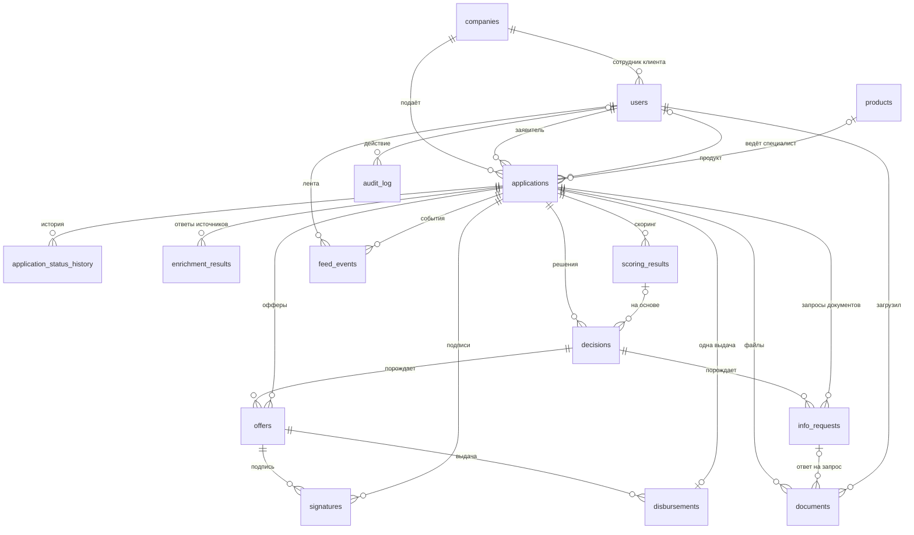

# Модель данных

Описана по моделям SQLAlchemy (`backend/app/db/models.py`), миграциям Alembic
(`backend/alembic/versions/`) и фактической схеме PostgreSQL 16.4 после `alembic upgrade head`
(ревизия `0007`). Контракт API — [api/README.md](api/README.md), процесс — [architecture.md](architecture.md).

## 1. Связи

`audit_log.application_id` — **без внешнего ключа**: журнал переживает сброс демо, который удаляет
заявки; номер заявки хранится в самой строке. Каскадного удаления (`ON DELETE`) в схеме нет:
порядок удаления при сбросе задан в коде (`services/admin.py`). Проверочных ограничений (`CHECK`)
в БД тоже нет: допустимые значения статусов и перечислений проверяет код.

Типы ниже — PostgreSQL: идентификаторы `uuid`, время `timestamptz`, деньги `numeric(14,2)`, ставки
`numeric(5,2)`, JSON — `jsonb`. «Строка» — `varchar`.

## 2. Таблицы

### Справочники и пользователи (миграция `0001`)

| Таблица | Поля | Ключи и ограничения |
| --- | --- | --- |
| `companies` | `id`, `inn` (12), `ogrn` (15), `kind` (`LLC` / `IE`), `name`, `okved_main`, `region`, `registered_at` (date), `segment` (`micro` / `small`) | PK `id`; **уникальный** `inn` |
| `users` | `id`, `email`, `password_hash` (bcrypt), `role` (`client` / `underwriter` / `admin`), `full_name`, `company_id` | PK `id`; **уникальный** `email`; `company_id` → `companies` (пусто у сотрудников банка) |
| `products` | `id`, `code`, `name`, `purpose_tags` (массив строк), `min_amount`, `max_amount`, `min_term`, `max_term`, `base_rate` | PK `id`; **уникальный** `code` |

### Заявка и её история (`0001`, `0005`)

| Таблица | Поля | Ключи и ограничения |
| --- | --- | --- |
| `applications` | `id`, `number`, `company_id`, `applicant_id`, `product_id`, `amount`, `term_months`, `purpose`, `revenue_12m`, `existing_payments_monthly`, `bki_consent`, `status`, `status_changed_at`, `version`, `submitted_at`, `created_at`, `assignee_id` | PK `id`; **уникальный** `number` (сквозной счётчик `0001`, `0002`, …); FK `company_id`, `applicant_id`, `product_id`, `assignee_id`; индекс `company_id`; `version` — оптимистическая блокировка |
| `application_status_history` | `id`, `application_id`, `from_status`, `to_status`, `actor_type` (`client` / `system` / `underwriter`), `actor_id`, `reason`, `created_at` | PK `id`; FK `application_id`; индекс `application_id` |

`applications.status` — один из 14 статусов (раздел 3). `assignee_id` — специалист, взявший
заявку в работу. Поля анкеты (`product_id`, `amount`, …, `existing_payments_monthly`) пусты в
черновике и обязательны к моменту отправки (проверяет `submit`, 422). Историю статусов пишет
`services/status.py::change_status` в одной транзакции с переходом; первая строка с пустым
`from_status` — создание черновика. Колонка `application_status_history.reason` есть в схеме, но
код её сейчас не заполняет.

### Обработка заявки (`0002`)

| Таблица | Поля | Ключи и ограничения |
| --- | --- | --- |
| `enrichment_results` | `id`, `application_id`, `source` (`egrul` / `egrip` / `fns_tb` / `bki`), `status` (`ok` / `not_found` / `unavailable`), `response` (jsonb), `attempts`, `error`, `fetched_at` | FK `application_id`; индекс `application_id` |
| `scoring_results` | `id`, `application_id`, `model_version` (версия `config.yaml`), `total_score`, `grade` (A–E), `factors` (jsonb), `created_at` | FK `application_id`; индекс |
| `decisions` | `id`, `application_id`, `scoring_result_id`, `outcome`, `reason_code`, `client_reason`, `rules_fired` (jsonb), `decided_by` (`system` / `underwriter`), `underwriter_id`, `comment`, `created_at` | FK `application_id`, `scoring_result_id`, `underwriter_id`; индекс `application_id` |
| `offers` | `id`, `application_id`, `decision_id`, `product_id`, `amount`, `term_months`, `rate`, `monthly_payment`, `status` (`active` / `accepted` / `declined`), `created_at` | FK `application_id`, `decision_id`, `product_id`; индекс `application_id` |
| `info_requests` | `id`, `application_id`, `decision_id`, `items` (jsonb), `message`, `status` (`open` / `answered`), `created_at` | FK `application_id`, `decision_id`; индекс `application_id` |

Заявка может пройти конвейер несколько раз (после `resubmit`), поэтому ответов источников,
скорингов и решений у неё бывает несколько; «текущий» — последний по `created_at`. Ответ
источника при каждом проходе записывается заново.

Содержимое JSON-колонок (проверено на живой БД):

- `scoring_results.factors`: `{"reference_date", "new_payment_base_rate", "debt_load_pct",
  "factors": [{"id": "F1", "name", "value", "band", "points", "max_points", "note"}, …]}`.
- `decisions.rules_fired`: `{"config_version", "rule", "staff_message", "checks": [{"rule":
  "R1", "fired": false, "detail": "…"}, …]}` — трасса проверок до сработавшего правила.
- `decisions.outcome` хранится **в верхнем регистре** (`APPROVED`, `COUNTER_OFFER`, `REJECTED`,
  `INFO_REQUESTED`, `MANUAL_REVIEW`); API отдаёт его в нижнем. `reason_code` — подробный код
  правила (`R9_APPROVED`), `client_reason` — код отказа для клиента (`company_inactive`, …).
- `info_requests.items`: пункты запроса `[{"kind", "title", "required", …}]`.
- `enrichment_results.response`: ответ источника как есть (`null` при сбое).

### Документы (`0003`)

| Таблица | Поля | Ключи и ограничения |
| --- | --- | --- |
| `documents` | `id`, `application_id`, `info_request_id`, `kind`, `filename`, `mime`, `size`, `sha256`, `storage_path`, `uploaded_by`, `created_at` | FK `application_id`, `info_request_id`, `uploaded_by`; индекс `application_id` |

`storage_path` — ключ файла в хранилище (UUID без расширения), исходное имя — в `filename`.
Виды документов: `tax_return`, `bank_statement`, `financial_statements`, `contract`, `other`.

### Подпись и выдача (`0004`)

| Таблица | Поля | Ключи и ограничения |
| --- | --- | --- |
| `signatures` | `id`, `application_id`, `offer_id`, `code_hash` (HMAC-SHA256), `attempts`, `expires_at`, `signed_at`, `signer_id`, `created_at` | FK `application_id`, `offer_id`, `signer_id`; индекс `application_id` |
| `disbursements` | `id`, `application_id`, `offer_id`, `amount`, `account_mask`, `executed_at` | **уникальный** `application_id` (одна выдача на заявку); FK `offer_id` |

Неподтверждённый код хранится в строке с пустым `signed_at`; новый запрос кода заменяет её.
`account_mask` — синтетический счёт `****4521`.

### Лента и журнал (`0006`, `0007`)

| Таблица | Поля | Ключи и ограничения |
| --- | --- | --- |
| `feed_events` | `id`, `user_id`, `application_id`, `status`, `title`, `body`, `read_at`, `created_at` | FK `user_id`, `application_id`; индексы по обоим |
| `audit_log` | `id`, `created_at`, `action`, `actor_role`, `actor_id`, `actor_name`, `application_id`, `application_number`, `summary` (≤ 200), `details` (jsonb), `ip` | FK только `actor_id`; индексы `created_at`, `application_id`; **только дописывается** |

Новости ленты в БД не хранятся: их читает `services/feed.py` из `seed/news.json`.
`audit_log.action` — одно из 17 действий (`auth.login`, `application.submitted`,
`bank.decision`, `demo.reset`, …; список — схема `AuditAction` в контракте).

## 3. Статусы заявки

Допустимые переходы заданы в одном месте — `backend/app/domain/state_machine.py` (14 статусов,
21 переход); диаграмма — [architecture.md](architecture.md), раздел 4.

| Статус | Значение | Кто переводит дальше |
| --- | --- | --- |
| `DRAFT` | черновик | клиент |
| `SUBMITTED`, `ENRICHMENT`, `SCORING` | шаги конвейера | система |
| `MANUAL_REVIEW` | ждёт специалиста | андеррайтер |
| `INFO_REQUESTED` | банк запросил документы | клиент |
| `APPROVED`, `COUNTER_OFFER` | оффер выдан | клиент |
| `REJECTED` | отказ | — (конечный) |
| `SIGNING` | оффер принят, ждёт подписи | клиент |
| `SIGNED` | подписано | система (выдача) |
| `ISSUED` | деньги выданы (симуляция) | — (конечный) |
| `DECLINED_BY_CLIENT`, `CANCELLED` | клиент отказался / отозвал заявку | — (конечные) |

## 4. Миграции

Применяются строго по цепочке (`alembic upgrade head`); в контейнере `api` — при каждом старте,
до загрузки демо-данных и запуска API.

| Ревизия | Файл | Что добавляет |
| --- | --- | --- |
| `0001` | `0001_auth_and_drafts.py` | `companies`, `users`, `products`, `applications`, `application_status_history` |
| `0002` | `0002_decision_results.py` | `enrichment_results`, `scoring_results`, `decisions`, `offers`, `info_requests` |
| `0003` | `0003_documents.py` | `documents` |
| `0004` | `0004_signing_and_disbursement.py` | `signatures`, `disbursements` |
| `0005` | `0005_application_assignee.py` | `applications.assignee_id` |
| `0006` | `0006_feed_events.py` | `feed_events` |
| `0007` | `0007_audit_log.py` | `audit_log` |

Каждая миграция имеет обратный шаг (`downgrade`). Согласованность проверяется в CI и тестами:
`alembic upgrade → downgrade base → upgrade` на PostgreSQL 16.4, а тест
`tests/unit/test_seed_and_migrations.py::test_migrations_match_models` сверяет миграции с моделями
SQLAlchemy (расхождений нет). Эндпоинт `/ready` отвечает 200 только если `alembic_version` равна
последней ревизии.

## 5. Демо-данные

`seed/` (загружается при `SEED_DEMO_DATA=true`, повторная загрузка безопасна): 7 компаний,
3 продукта, 9 учётных записей. Заявок в `seed/` нет — они создаются в ходе демо, а
`POST /admin/demo/reset` удаляет все заявки со связанными строками и файлами, оставляя
компании, продукты, учётки и журнал.
