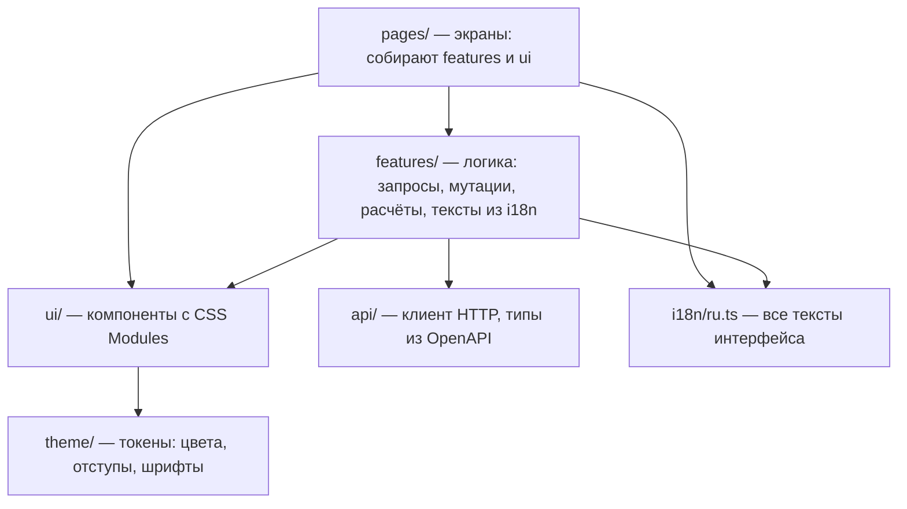

# Архитектура frontend

React 19 + TypeScript + Vite, данные — TanStack Query. Один веб-интерфейс для трёх ролей: клиент, кредитный специалист, администратор. Мобильного приложения нет. Запуск и режимы данных — [frontend/README.md](../frontend/README.md).

## 1. Экраны

| Путь | Экран | Роль |
| --- | --- | --- |
| `/login` | вход, подсказка с демо-учётками | все |
| `/` | главная: заявки по группам «ждут вас / в работе / завершены», лента | клиент |
| `/products` | подбор продукта по цели, сумме и сроку | клиент |
| `/applications/:id/edit` | анкета с автосохранением и данными из реестра | клиент |
| `/applications/:id` | карточка заявки: этапы, запрос документов, загрузка, история | клиент |
| `/applications/:id/result` | решение: одобрение, другие условия, отказ с объяснением | клиент |
| `/applications/:id/signing` | подписание кодом и выдача, график платежей | клиент |
| `/feed` | лента: события по заявкам и новости с причинами показа | клиент |
| `/bank` | очередь заявок с фильтрами | специалист, админ |
| `/bank/applications/:id` | карточка B3: источники, скоринг, правила, документы, журнал; решение B4 | специалист; админ — только чтение |
| `/admin` | журнал действий и сброс демо-данных | админ |

После входа каждая роль попадает на свой экран (`features/routes.ts`, `homeFor`); чужие маршруты недоступны.

## 2. Слои

- В `pages/` и `features/` нет CSS, `className` и `style`: внешний вид задаётся только в `ui/`. Правило проверяет `scripts/check-layers.mjs` перед каждой сборкой.
- Цвета, отступы, радиусы и шрифты — только токены из `theme/tokens.css`. Две темы поверхностей: «Жемчуг» и «Графит».
- Все тексты — в `i18n/ru.ts`, в компонентах строк нет.

## 3. Данные и API

- Типы запросов и ответов генерируются из контракта: `npm run api:types` → `src/api/schema.ts` из `docs/api/openapi.json`.
- `api/client.ts`: токен входа, заголовок `Authorization`, `Idempotency-Key` для операций, которые нельзя повторять, разбор ошибок `{code, message, field}`.
- Заявки и очередь банка опрашиваются раз в 3 секунды, лента — раз в 15, журнал — раз в 6: статусы меняются без перезагрузки.
- Файлы клиента открываются запросом с токеном, тип задаётся по белому списку (PDF, JPEG, PNG): загруженный HTML не откроется как страница.

## 4. Режимы данных

`VITE_API_MODE` выбирает, кто отвечает на запросы:

| Режим | Где по умолчанию | Что происходит |
| --- | --- | --- |
| `real` | Docker | все запросы в API, моки в браузер не грузятся |
| `mocks` | `npm run dev` | все ответы — MSW в браузере (`src/mocks/`), бэк не нужен |
| `mixed` | `npm run dev:mixed` | операции из `src/mocks/real-operations.json` в API, остальное — моки |

Моки повторяют логику бэка: правила решения, скоринг, график, ранжирование ленты той же формулой (`mocks/feedRanking.ts`, новости — копия `seed/news.json`). Список реальных операций и копию новостей сверяют тесты бэкенда.

## 5. Сборка и доставка

`frontend/Dockerfile`: `npm ci` по `package-lock.json` → `npm run build` (проверка слоёв, `tsc`, Vite) → статика в `nginx:1.27-alpine`. nginx отдаёт SPA, проксирует `/api/` в сервис `api` и перезаписывает `X-Forwarded-For` адресом клиента, чтобы IP в журнале действий нельзя было подделать.
