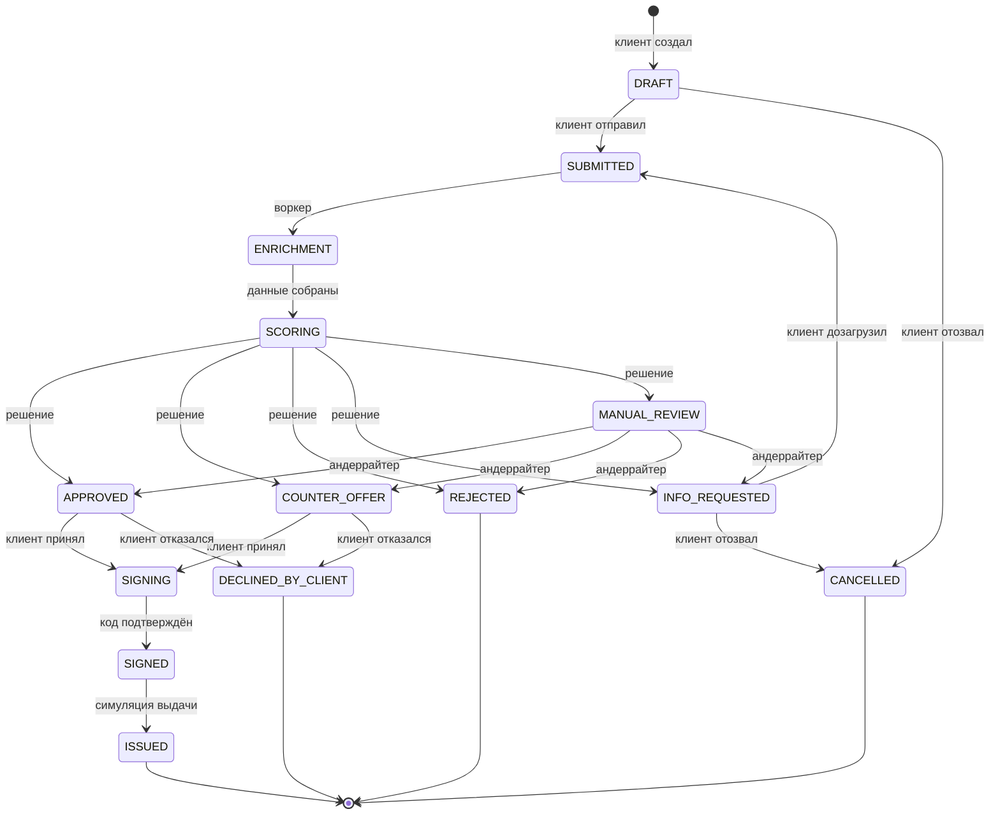
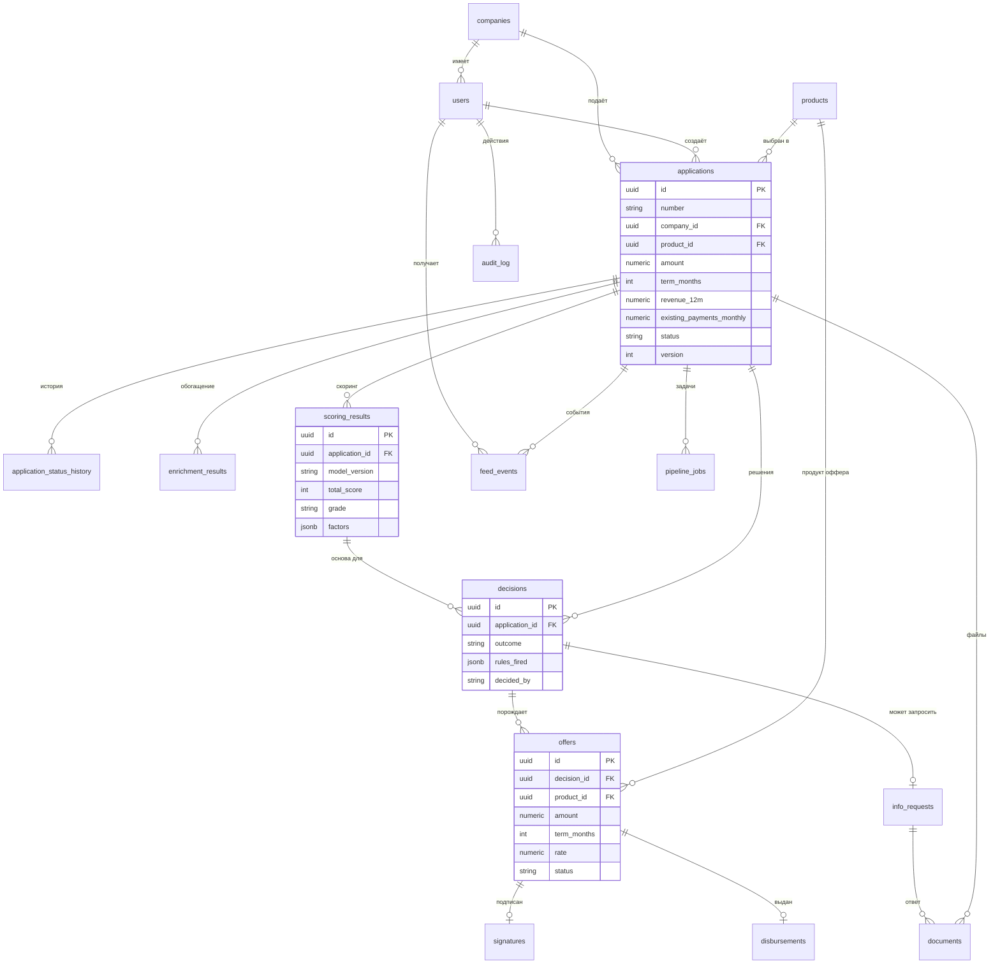
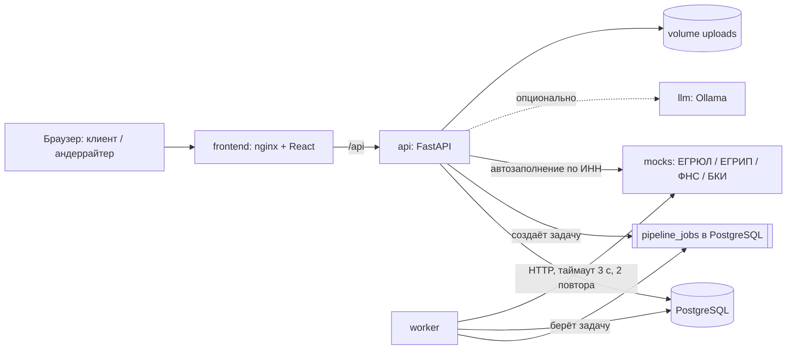

# План: Умный кредитный кабинет предпринимателя

> Версия плана от 20.10.2026

Кейс хакатона Альфа-Банка. Команда 5 человек, 7 дней. Стек: FastAPI + PostgreSQL + React/Vite, запуск через Docker Compose.

## Содержание

- [1. Краткое понимание задачи](#1-краткое-понимание-задачи)
- [2. Пользователи и их задачи](#2-пользователи-и-их-задачи)
- [3. Границы MVP — MoSCoW](#3-границы-mvp--moscow)
- [4. Модель кредитного процесса](#4-модель-кредитного-процесса)
- [5. Статусы заявки](#5-статусы-заявки)
- [6. Модель данных](#6-модель-данных)
- [7. Скоринг и кредитное решение](#7-скоринг-и-кредитное-решение)
- [8. Моки внешних сервисов](#8-моки-внешних-сервисов)
- [9. Архитектура](#9-архитектура)
- [10. Список API](#10-список-api)
- [11. Экраны](#11-экраны)
- [12. Где ИИ даёт ценность](#12-где-ии-даёт-ценность)
- [13. План по дням](#13-план-по-дням)
- [14. Чек-лист сдачи](#14-чек-лист-сдачи)
- [15. Сценарий демо на 5–7 минут](#15-сценарий-демо-на-57-минут)
- [16. Риски](#16-риски)
- [17. Структура репозитория](#17-структура-репозитория)
- [Допущения, которые стоит подтвердить](#допущения-которые-стоит-подтвердить)

## 1. Краткое понимание задачи

Нужен работающий кредитный конвейер: клиент проходит путь от выбора продукта до выдачи, банк обрабатывает заявку в том же продукте. Жюри оценивает по 6 критериям из кейса (стр. 9):

1. **Целостность решения.** Один связный путь: подбор продукта → заявка → проверки → скоринг → решение → подписание → выдача (симуляция). Обрывов «тут у нас заглушка экрана» быть не должно.
2. **Готовность к проверке.** Эксперт сам клонирует репозиторий, делает `docker compose up --build`, логинится тестовой учёткой и проходит сценарий по README. Без нас.
3. **Качество UX.** Клиент без банковской экспертизы на каждом шаге видит: где заявка, почему так, что делать дальше. Сотрудник банка видит все данные и причины автоматического решения.
4. **Согласованность модулей.** Данные вводятся один раз (ИНН → автозаполнение из ЕГРЮЛ/ЕГРИП), сохраняются и используются дальше. Статус меняется только по разрешённым переходам, история пишется.
5. **Enterprise-ориентированность.** Роли и доступы, аудит, миграции БД, lock-файлы, healthcheck, таймауты и ретраи к внешним сервисам, тесты, конфиги через env.
6. **Потенциал развития.** В доках явно описаны: что вошло в MVP и почему, допущения, ограничения, как развивать дальше.
7. **Отдельно на демо:** показать, как меняется новостная лента под клиента и что в ней. ИИ — только бонус, основной сценарий работает без него.

## 2. Пользователи и их задачи

В MVP три роли в системе: `client`, `underwriter`, `admin`. Роли клиента из кейса (собственник, директор, бухгалтер и др.) в MVP — один тип пользователя `client`. \[допущение\] Один пользователь на компанию: разграничение прав внутри компании не даёт ценности на демо, а стоит 1–2 дня.

| Роль | Кто это | Главные задачи (JTBD) |
| --- | --- | --- |
| Клиент: собственник / ИП / директор | Решает, брать ли кредит | 1) Когда у бизнеса появилась потребность в деньгах, хочу быстро понять, какой продукт мне подходит и сколько я буду платить, чтобы не разбираться в банковских терминах. 2) Когда заявка подана, хочу видеть её статус и что от меня нужно, чтобы не звонить в банк. |
| Клиент: бухгалтер / финдиректор | Готовит данные и документы | Когда банк просит документы, хочу загрузить их прямо в заявку и не вводить заново то, что уже есть в реестрах. |
| Банк: андеррайтер (кредитный специалист) | Разбирает нестандартные заявки | 1) Когда автоматика не смогла решить, хочу видеть все данные, скоринг и сработавшие правила на одном экране, чтобы быстро принять решение. 2) Когда данных не хватает, хочу запросить у клиента конкретный список документов внутри продукта. |
| Банк: администратор | Отвечает за демо-стенд | Хочу сбросить демо-данные и посмотреть журнал действий, чтобы демо было воспроизводимым. |
| Система (конвейер) | Автоматический исполнитель | Проверить полноту, обогатить данные из ЕГРЮЛ/ЕГРИП/ФНС/БКИ, посчитать скоринг, принять решение по правилам и перевести статус. |

В кейсе есть задача «исследуйте потребности пользователей». Закрываем её коротко: аналитик делает 3–5 интервью или анкету с знакомыми предпринимателями плюс desk research. Результат — `docs/research.md` с выводами и связью «потребность → функция».

## 3. Границы MVP — MoSCoW

В MVP входит один полный путь с 4 исходами и ролью андеррайтера. Всё, что не нужно для этого пути, вынесено в Could/Won't.

| Приоритет | Что | Почему |
| --- | --- | --- |
| Must | Вход по логину/паролю, роли `client` / `underwriter` / `admin` | Без ролей нет банковской части и проверки доступа |
| Must | Каталог из 3 синтетических продуктов + подбор продукта по цели, сумме, сроку | Шаг «выбор продукта» из кейса; клиент не эксперт |
| Must | Мастер заявки с автосохранением черновика и автозаполнением по ИНН | Кейс: «сокращать повторный ввод», «данные сохраняются» |
| Must | Проверка полноты и корректности (обязательные поля, контрольная сумма ИНН, лимиты продукта) | Этап из «Минимального сквозного пути» |
| Must | Машина состояний заявки + история переходов | Критерий 4: статус меняется последовательно |
| Must | Моки ЕГРЮЛ, ЕГРИП, ФНС «Прозрачный бизнес», БКИ | Прямо названы в кейсе; автономность |
| Must | Скоринг (балльная модель) и отдельный движок решения | Кейс требует разделять эти шаги |
| Must | 4 исхода: одобрение, другие условия, отказ, запрос доп. информации | Кейс: итог не бинарный |
| Must | Кабинет андеррайтера: очередь, карточка, решение | Роль банка и ручная обработка |
| Must | Запрос документов и загрузка файла в заявку | Исход «запрос доп. информации» должен быть рабочим |
| Must | Симуляция подписания (код на экране) и выдачи | Кейс: моделировать без реальных операций |
| Must | Персональная лента (события по заявке + новости по профилю клиента) | Требование демо; заменяет email/SMS внутри продукта |
| Must | Docker Compose одной командой, сиды, тестовые учётки, пакет доков | Формат сдачи |
| Must | Тесты: скоринг, решение, переходы статусов, один e2e по API | Готовность к проверке, enterprise |
| Should | График платежей (аннуитет) в оффере | Клиенту понятнее, стоит полдня |
| Should | Объяснение решения клиенту простым языком | Критерий UX |
| Should | Журнал аудита на экране | Enterprise, данные уже пишутся |
| Should | Облачный деплой | Желательно по кейсу |
| Should | `docs/research.md` (интервью/анкета) | Задача 1 кейса |
| Could | ИИ: подбор продукта по свободному тексту | Ценность для неэксперта, но не обязательно |
| Could | ИИ: сводка по заявке для андеррайтера | Ускоряет ручной разбор |
| Could | Несколько пользователей на компанию с правами | Мало ценности на демо |
| Could | Дашборд метрик конвейера (сколько заявок по статусам) | Красиво, но не влияет на путь |
| Won't | Мобильное приложение | Запрещено кейсом |
| Won't | Email, SMS, мессенджеры, звонки | Запрещено кейсом; уведомления только в ленте |
| Won't | Реальные ЕГРЮЛ/ФНС/БКИ, платные API | Запрещено кейсом; только моки |
| Won't | Реальная ЭП и реальные платежи | Кейс разрешает симуляцию |
| Won't | ML-модель скоринга | Нет данных для обучения; прозрачные правила понятнее жюри |
| Won't | Залоги, поручители, кредитный комитет | Слишком большой объём на 7 дней |
| Won't | Сопровождение кредита после выдачи (погашения, просрочки) | За пределами пути «до результата» |
| Won't | Распознавание документов (OCR) | Ценно, но риск по сроку; файл проверяет андеррайтер |

## 4. Модель кредитного процесса

Процесс из 10 этапов. Этапы 3–5 выполняет фоновый воркер без участия людей; человек подключается только на этапе 6.

| # | Этап | Кто действует | Какие данные нужны | Что на выходе |
| --- | --- | --- | --- | --- |
| 0 | Потребность и подбор продукта | Клиент | Цель (оборотные средства / оборудование / кассовый разрыв), сумма, срок | 1–3 подходящих продукта с примерным платежом |
| 1 | Черновик заявки | Клиент | ИНН → автозаполнение из ЕГРЮЛ/ЕГРИП; сумма, срок, цель; выручка за 12 мес, текущие ежемесячные платежи по кредитам; согласие на запрос в БКИ (галочка) | Заявка `DRAFT`, сохраняется при каждом шаге |
| 2 | Подача и проверка полноты | Клиент → система | Все обязательные поля, ИНН с верной контрольной суммой, сумма и срок в лимитах продукта | `SUBMITTED` или ошибка 422 с понятным текстом у поля |
| 3 | Обогащение данных | Система (воркер) | ИНН, согласие на БКИ | Ответы 4 источников в `enrichment_results`; при сбое источника — 2 повтора, потом флаг «источник недоступен» |
| 4 | Скоринг | Система | Анкета + обогащённые данные | Балл 0–100, грейд A–E, разбивка по 6 факторам (`scoring_results`) |
| 5 | Кредитное решение | Система (движок правил) | Скоринг, стоп-факторы, лимиты продукта, долговая нагрузка | Одно из: одобрение, другие условия, отказ, запрос информации, ручное рассмотрение (`decisions`) + оффер (`offers`) |
| 6 | Ручное рассмотрение | Андеррайтер | Всё из этапов 1–5, загруженные документы | Финальное решение с комментарием (одно из 4) |
| 7 | Ответ клиента | Клиент | Оффер или запрос информации | Оффер принят / отклонён; или документы загружены и заявка отправлена повторно (возврат на этап 3) |
| 8 | Подписание (симуляция) | Клиент | Принятый оффер, сгенерированный договор (HTML/PDF-заглушка) | Одноразовый код показывается в интерфейсе, клиент вводит его → запись в `signatures` |
| 9 | Выдача (симуляция) | Система | Подписанный договор | Запись в `disbursements`, статус «Выдан», график платежей, событие в ленте |

Ключевые правила связности:

- Данные из реестров на шаге 1 клиент не редактирует, только видит. Это защищает от расхождений и исключает повторный ввод.
- Каждый переход статуса пишет строку в `application_status_history` и событие в ленту клиента. Это и есть «уведомления» внутри продукта вместо email/SMS.
- Скоринг всегда считается и сохраняется, даже если решение — отказ по стоп-фактору. Андеррайтер видит обе вещи отдельно.

## 5. Статусы заявки

14 статусов, все переходы — в одном модуле `backend/app/domain/state_machine.py`. Недопустимый переход возвращает `409 Conflict`. Каждый переход пишется в `application_status_history`.

| Статус | Что значит для клиента | Кто ставит |
| --- | --- | --- |
| `DRAFT` | Черновик, можно редактировать | Клиент (создание) |
| `SUBMITTED` | Заявка отправлена | Клиент |
| `ENRICHMENT` | Банк проверяет данные о компании | Воркер |
| `SCORING` | Банк оценивает заявку | Воркер |
| `MANUAL_REVIEW` | Заявку смотрит специалист | Движок решения |
| `INFO_REQUESTED` | Нужны документы или уточнения | Движок решения / андеррайтер |
| `APPROVED` | Одобрено на запрошенных условиях | Движок решения / андеррайтер |
| `COUNTER_OFFER` | Одобрено на других условиях | Движок решения / андеррайтер |
| `REJECTED` | Отказ с понятной причиной | Движок решения / андеррайтер |
| `SIGNING` | Оффер принят, нужно подписать документы | Клиент |
| `SIGNED` | Документы подписаны | Клиент (ввод кода) |
| `ISSUED` | Деньги выданы (симуляция) | Воркер |
| `DECLINED_BY_CLIENT` | Клиент отказался от предложения | Клиент |
| `CANCELLED` | Клиент отозвал заявку | Клиент |

Переходы:

| Из | В | Причина |
| --- | --- | --- |
| `DRAFT` | `SUBMITTED` | Клиент нажал «Отправить», проверка полноты прошла |
| `SUBMITTED` | `ENRICHMENT` | Воркер взял задачу |
| `ENRICHMENT` | `SCORING` | Все 4 источника ответили или исчерпаны повторы |
| `SCORING` | `APPROVED` / `COUNTER_OFFER` / `REJECTED` / `INFO_REQUESTED` / `MANUAL_REVIEW` | Движок решения (правила в разделе 7) |
| `MANUAL_REVIEW` | `APPROVED` / `COUNTER_OFFER` / `REJECTED` / `INFO_REQUESTED` | Андеррайтер |
| `INFO_REQUESTED` | `SUBMITTED` | Клиент загрузил документы и отправил повторно |
| `APPROVED`, `COUNTER_OFFER` | `SIGNING` | Клиент принял оффер |
| `APPROVED`, `COUNTER_OFFER` | `DECLINED_BY_CLIENT` | Клиент отказался |
| `SIGNING` | `SIGNED` | Клиент ввёл верный код |
| `SIGNED` | `ISSUED` | Воркер провёл симуляцию выдачи |
| `DRAFT`, `INFO_REQUESTED` | `CANCELLED` | Клиент отозвал заявку |

Воркер делает паузу 2–3 секунды на шаг (`PIPELINE_STEP_DELAY_SEC`), чтобы на демо было видно, как статус меняется вживую. Фронт опрашивает заявку каждые 3 секунды. Выбрал polling, а не WebSocket: проще, надёжнее на чужом ПК и через прокси.



Эта же диаграмма лежит в `docs/state-diagram.md` и должна совпадать с кодом. Тест `test_state_machine.py` проверяет, что каждое ребро диаграммы разрешено, а остальные запрещены.

## 6. Модель данных

17 таблиц в PostgreSQL, миграции через Alembic. Сырые ответы моков храним в `jsonb`, чтобы андеррайтер видел «что пришло из источника», а скоринг брал нужные поля.

| Таблица | Ключевые поля | Зачем |
| --- | --- | --- |
| `users` | id, email, password\_hash, role (`client`/`underwriter`/`admin`), full\_name, company\_id | Вход и роли |
| `companies` | id, inn (unique), ogrn, kind (`LLC`/`IE`), name, okved\_main, region, registered\_at, segment (`micro`/`small`) | Профиль клиента; заполняется из ЕГРЮЛ/ЕГРИП |
| `products` | id, code, name, purpose\_tags\[\], min\_amount, max\_amount, min\_term, max\_term, base\_rate | Каталог |
| `applications` | id, number, company\_id, applicant\_id, product\_id, amount, term\_months, purpose, revenue\_12m, existing\_payments\_monthly, bki\_consent, status, version, submitted\_at | Заявка; `version` — защита от двойного изменения |
| `application_status_history` | id, application\_id, from\_status, to\_status, actor\_type (`client`/`system`/`underwriter`), actor\_id, reason, created\_at | История статусов |
| `enrichment_results` | id, application\_id, source (`egrul`/`egrip`/`fns_tb`/`bki`), status (`ok`/`not_found`/`error`), response jsonb, attempts, fetched\_at | Обогащение |
| `scoring_results` | id, application\_id, model\_version, total\_score, grade, factors jsonb, created\_at | Скоринг |
| `decisions` | id, application\_id, scoring\_result\_id, outcome, rules\_fired jsonb, decided\_by (`system`/`underwriter`), underwriter\_id, comment, reason\_code | Кредитное решение |
| `offers` | id, application\_id, decision\_id, product\_id, amount, term\_months, rate, monthly\_payment, status (`active`/`accepted`/`declined`) | Условия для клиента |
| `info_requests` | id, application\_id, decision\_id, items jsonb, message, status (`open`/`answered`) | Запрос доп. информации |
| `documents` | id, application\_id, info\_request\_id, kind, filename, mime, size, sha256, storage\_path, uploaded\_by | Файлы клиента и договор |
| `signatures` | id, application\_id, offer\_id, document\_id, code\_hash, attempts, signed\_at, signer\_id | Симуляция подписи |
| `disbursements` | id, application\_id, offer\_id, amount, account\_mask, executed\_at | Симуляция выдачи |
| `feed_events` | id, user\_id, application\_id, type, title, body, read\_at, created\_at | События по заявке в ленте |
| `news_items` | id, title, body, tags jsonb (okved, segment, product, status), priority, published\_at | Синтетические новости |
| `audit_log` | id, actor\_id, action, entity, entity\_id, payload jsonb, ip, created\_at | Кто что сделал |
| `pipeline_jobs` | id, application\_id, step, status, attempts, run\_after, last\_error | Очередь воркера |

Конфиг скоринга и правил решения — файл `backend/app/scoring/config.yaml` с версией. Версия пишется в `scoring_results.model_version`. Так правила видны в репозитории и в ревью.



## 7. Скоринг и кредитное решение

Скоринг отвечает на вопрос «насколько рискованный клиент» (балл 0–100). Решение отвечает на вопрос «что предложить по этой заявке» и учитывает ещё стоп-факторы, продукт, сумму, срок и нагрузку. Это два разных модуля: `scoring/engine.py` и `decision/engine.py`.

### Продукты (синтетические) \[допущение\]

| Код | Название | Сумма | Срок | Базовая ставка |
| --- | --- | --- | --- | --- |
| `EXPRESS_WC` | Экспресс-оборот | 0,3–5 млн ₽ | 3–24 мес | 18% |
| `EQUIPMENT` | Инвест-оборудование | 1–30 млн ₽ | 12–60 мес | 16% |
| `OVERDRAFT` | Овердрафт для бизнеса | 0,1–3 млн ₽ | 12 мес | 20% |

### Скоринг: 6 факторов, максимум 100 баллов

**Нагрузка** = (текущие платежи в месяц + платёж по новому кредиту) / (выручка за 12 мес / 12). Платёж — аннуитет. В скоринге он считается по базовой ставке продукта на запрошенных условиях.

| Фактор | Источник | Значения → баллы | Макс |
| --- | --- | --- | --- |
| F1 Возраст бизнеса | ЕГРЮЛ / ЕГРИП | < 1 года → 0; 1–2 → 8; 2–5 → 15; > 5 → 20 | 20 |
| F2 Кредитная история | БКИ | Нет просрочек за 24 мес → 25; просрочка до 30 дн → 15; нет истории → 10; 30–90 дн → 5; > 90 дн → 0 | 25 |
| F3 Нагрузка | Анкета + БКИ | ≤ 25% → 20; 25–35% → 12; 35–50% → 4; > 50% → 0 | 20 |
| F4 Динамика выручки | ФНС «Прозрачный бизнес» | Рост или 0 → 15; нет данных за прошлый год → 8; падение до 20% → 8; падение > 20% → 0 | 15 |
| F5 Налоговая задолженность | ФНС «Прозрачный бизнес» | Нет → 10; до 100 тыс ₽ → 4; больше → 0 | 10 |
| F6 Признаки риска | ФНС (массовый адрес, недостоверность адреса или руководителя) | 0 флагов → 10; 1 → 3; 2+ → 0 | 10 |

Грейд: **A** ≥ 80, **B** 65–79, **C** 50–64, **D** 35–49, **E** < 35.

### Кредитное решение: правила по порядку, срабатывает первое

| Правило | Условие | Решение |
| --- | --- | --- |
| R1 | Статус компании в ЕГРЮЛ/ЕГРИП не «действующая» | `REJECTED` (причина: «компания ликвидирована») |
| R2 | Банкротство или текущая просрочка > 90 дней в БКИ | `REJECTED` |
| R3 | Источник не ответил после 2 повторов | `MANUAL_REVIEW` (флаг «нет данных БКИ») |
| R4 | Выручка в анкете отличается от ФНС больше чем на 30%. Документа нет → запрос; документ загружен → человек | `INFO_REQUESTED` (декларация или выписка) / `MANUAL_REVIEW` |
| R5 | Сумма > 10 млн ₽ | `MANUAL_REVIEW` |
| R6 | Грейд E | `REJECTED` |
| R7 | Грейд D | `MANUAL_REVIEW` |
| R8 | Грейд C | `COUNTER_OFFER`: сумма = меньшее из 50% запрошенной и максимума при нагрузке ≤ 35%; ставка база + 4 п.п. |
| R9 | Грейд A/B и нагрузка ≤ 35% | `APPROVED`: ставка база + 0 (A) или + 2 п.п. (B) |
| R10 | Грейд A/B и нагрузка > 35% | `COUNTER_OFFER`: сначала длиннее срок (шаг 6 мес, до максимума продукта), потом меньше сумма, потом другой продукт. Ничего не подошло → `REJECTED` |

Одинаковый скоринг даёт разный результат для разных продуктов: правила R5, R9, R10 зависят от лимитов и ставки продукта. Это прямо требование кейса (стр. 14). Пороги экспертные, не обучены на данных \[допущение\]; все числа живут в `config.yaml`.

### Примеры расчёта

**Клиент 1. ООО «Пекарня Север»** (ИНН 7701000019). Работает 7 лет, просрочек нет, выручка 24 млн ₽/год (+12% к прошлому году), платежи по кредитам 150 тыс ₽/мес. Просит «Экспресс-оборот» 3 млн ₽ на 12 мес.

- Платёж при 18% = 275 040 ₽. Нагрузка = (150 000 + 275 040) / 2 000 000 = 21,3%.
- F1 20 + F2 25 + F3 20 + F4 15 + F5 10 + F6 10 = **100, грейд A**.
- R1–R8 не сработали, R9: A и нагрузка ≤ 35% → **APPROVED**: 3 млн ₽, 12 мес, 18%, платёж 275 040 ₽.

**Клиент 2. ИП Ковалёв А.С.** (ИНН 500100001072). 3 года, одна просрочка до 30 дней, выручка 6 млн ₽/год (+5%), платежи 60 тыс ₽/мес. Просит «Экспресс-оборот» 2 млн ₽ на 12 мес.

- Платёж при 18% = 183 360 ₽. Нагрузка = (60 000 + 183 360) / 500 000 = 48,7%.
- F1 15 + F2 15 + F3 4 + F4 15 + F5 10 + F6 10 = **69, грейд B**.
- R10: нагрузка > 35%. Ставка для B = 20%. 18 мес → платёж 129 526 ₽, нагрузка 37,9% — мало. 24 мес → платёж 101 792 ₽, нагрузка 32,4% — подходит.
- **COUNTER\_OFFER**: 2 млн ₽ на 24 мес под 20%, платёж 101 792 ₽. Клиент видит «просили / предлагаем» рядом.

**Клиент 3. ИП Мельникова Е.В.** (ИНН 500100002020). 1,5 года, кредитной истории нет, в анкете выручка 12 млн ₽/год, по ФНС — 7 млн ₽. Платежей нет. Просит «Экспресс-оборот» 1,5 млн ₽ на 12 мес.

- Платёж при 18% = 137 520 ₽. Нагрузка по анкете = 13,8%.
- F1 8 + F2 10 + F3 20 + F4 8 + F5 10 + F6 10 = **66, грейд B**.
- R4: расхождение выручки (12 − 7) / 7 = 71% > 30%, документа нет → **INFO\_REQUESTED** («загрузите декларацию за прошлый год»).
- Клиент загрузил файл и отправил повторно → конвейер прошёл заново, R4 → **MANUAL\_REVIEW**. Андеррайтер видит нагрузку по выручке ФНС: 138 952 / 583 333 = 23,8% при ставке 20% и **одобряет вручную**.

Отказ на демо показываем на ООО «СтройРесурс»: скоринг посчитан и сохранён, но R1 (компания ликвидирована) даёт **REJECTED**. Это наглядно разделяет скоринг и решение.

## 8. Моки внешних сервисов

Один отдельный сервис `mocks` (FastAPI, порт 8081) с 4 группами эндпоинтов. Данные — JSON-фикстуры в `mocks/fixtures/` по ИНН. Отдельный контейнер, а не функции внутри бэкенда: так видна настоящая сетевая интеграция с таймаутами и ошибками, и мок легко заменить реальным адаптером.

| Сервис | Контракт (упрощённый) | Ответ |
| --- | --- | --- |
| ЕГРЮЛ | `GET /egrul/v1/companies/{inn}` | `{inn, ogrn, name, status: ACTIVE\|LIQUIDATING\|LIQUIDATED, registered_at, okved_main, okved_extra[], director{fio, inn}, founders[], address, region}`; 404 если нет |
| ЕГРИП | `GET /egrip/v1/entrepreneurs/{inn}` | `{inn, ogrnip, fio, status, registered_at, okved_main, region}`; 404 если нет |
| ФНС «Прозрачный бизнес» | `GET /fns-tb/v1/profile/{inn}` | `{revenue: {"2024": n, "2025": n}, tax_debt_rub, msp_category, employees, flags: {mass_address, unreliable_address, unreliable_director}}` |
| БКИ | `POST /bki/v1/reports` тело `{inn, consent: true}` | `{report_id, has_history, bankruptcy, loans: [{type, balance, monthly_payment, max_overdue_days_24m, current_overdue_days}], inquiries_30d}`; 400 без согласия |

Настройки мока через env: `MOCK_LATENCY_MS` (задержка, по умолчанию 300) и сценарий ошибки по ИНН. Бэкенд ходит в моки через адаптеры `backend/app/integrations/*.py` с таймаутом 3 с и 2 повторами.

### Тестовые случаи

| ИНН | Клиент | Что отдают моки | Ожидаемый итог |
| --- | --- | --- | --- |
| 7701000019 | ООО «Пекарня Север», ОКВЭД 10.71 | Всё чисто, 7 лет, рост выручки | `APPROVED` |
| 500100001072 | ИП Ковалёв А.С., ОКВЭД 47.11 | Просрочка до 30 дней, высокая нагрузка | `COUNTER_OFFER` (срок 24 мес) |
| 500100002020 | ИП Мельникова Е.В., ОКВЭД 96.02 | Нет КИ, выручка ФНС 7 млн при 12 в анкете | `INFO_REQUESTED` → `MANUAL_REVIEW` |
| 7701000026 | ООО «СтройРесурс», ОКВЭД 41.20 | ЕГРЮЛ: `LIQUIDATED` | `REJECTED` (R1) |
| 7701000033 | ООО «Вектор» | БКИ: текущая просрочка 120 дней | `REJECTED` (R2) |
| 7701000058 | ООО «Мираж» | 2 флага ФНС, налоговый долг 250 тыс ₽, падение выручки 25%, просрочка 30–90 дн → 40 баллов, грейд D | `MANUAL_REVIEW` (R7) |
| 7701000065 | ООО «Сбой-Тест» | БКИ всегда отвечает 503 | Повторы → `MANUAL_REVIEW` (R3) |
| 7701000072 | — | Нет в реестре, 404 | Ошибка на шаге автозаполнения: «компания не найдена» |

Все ИНН проходят проверку контрольной суммы, поэтому валидация на шаге 2 их пропускает. Названия, ФИО и цифры придуманы \[допущение: синтетика\].

## 9. Архитектура

Пять контейнеров в базовом запуске и один опциональный для ИИ. Бэкенд и воркер — один код, два процесса.

| Компонент | Технология | Что делает | Порт |
| --- | --- | --- | --- |
| `frontend` | React + Vite + TypeScript, собран и отдан через nginx | Кабинет клиента и банка; nginx проксирует `/api` на `api` | 8080 (наружу) |
| `api` | Python 3.12, FastAPI, SQLAlchemy 2, Alembic, Pydantic 2 | REST API, авторизация, статусы, Swagger на `/api/docs` | 8000 |
| `worker` | Тот же образ, `python -m app.worker` | Берёт задачи из `pipeline_jobs` (`SELECT … FOR UPDATE SKIP LOCKED`): обогащение → скоринг → решение → выдача | — |
| `db` | PostgreSQL 16 | Все данные | 5432 (только внутри сети) |
| `mocks` | FastAPI | ЕГРЮЛ, ЕГРИП, ФНС, БКИ | 8081 |
| `llm` (профиль `ai`) | Ollama + открытая модель | Только для 2 ИИ-функций из раздела 12 | 11434 |

Почему очередь в PostgreSQL, а не Redis/Celery: на один контейнер меньше, задачи переживают перезапуск, для демо нагрузки хватает. Файлы документов — в volume `uploads`, доступ через интерфейс `Storage`, чтобы потом подключить S3-совместимое хранилище.



### Запуск в Docker Compose

- `cp .env.example .env && docker compose up --build` — поднимает `db`, `mocks`, `api`, `worker`, `frontend`. Открыть `http://localhost:8080`.
- `api` при старте делает `alembic upgrade head` и `python -m app.seed` (идемпотентно: повторный запуск не дублирует данные).
- У каждого сервиса `healthcheck`; `api` ждёт `db` и `mocks` через `depends_on: condition: service_healthy`.
- `docker compose --profile ai up --build` — дополнительно `llm`. Без профиля ИИ выключен, `AI_ENABLED=false`.
- Образы с фиксированными тегами (`postgres:16.4-alpine`, `python:3.12-slim`, `node:20-alpine`, `nginx:1.27-alpine`), поддерживают amd64 и arm64.

### Безопасность и надёжность (критерий 5)

- JWT с ролями; проверка не только роли, но и владельца: клиент видит только заявки своей компании (тест на это есть).
- Пароли — bcrypt. Код подписи хранится как хэш, 3 попытки.
- Загрузка файлов: до 10 МБ, только PDF/JPG/PNG, имя на диске — UUID, сохраняем sha256.
- `Idempotency-Key` на `submit`, `accept`, `signing/confirm` — двойной клик не создаёт дубль.
- Поле `version` в заявке — защита от гонки между клиентом и андеррайтером (409 при конфликте).
- `audit_log` на все изменения; структурные JSON-логи с `request_id`.
- Секреты только из env, в репозитории только `.env.example`.

### Как фронт отделён от дизайна (под шаблон с refero)

Цель: дизайн меняется заменой 2 папок, страницы и логика не трогаются.

- `frontend/src/api/` — типизированный клиент, сгенерированный из `openapi.json` (`openapi-typescript`). Фронт знает о бэке только через него.
- `frontend/src/features/` — логика и данные (TanStack Query, хуки `useApplication`, `useFeed`). Без стилей.
- `frontend/src/pages/` — страницы собираются только из компонентов `ui/`. Запрещено: цвета, отступы, шрифты в страницах; классы сторонних UI-библиотек.
- `frontend/src/ui/` — свои базовые компоненты: `Button`, `Input`, `Select`, `Card`, `Badge`, `StatusTimeline`, `Table`, `Modal`, `FileUpload`, `Stepper`. Стили — CSS Modules, значения только из токенов.
- `frontend/src/theme/tokens.css` — дизайн-токены как CSS-переменные: `--color-*`, `--font-*`, `--radius-*`, `--space-*`, `--shadow-*`. Статусы получают цвета через токены `--status-approved` и т. п.
- Все тексты интерфейса — в `frontend/src/i18n/ru.ts`.

Когда придёт шаблон: переносим его палитру, шрифты, радиусы в `tokens.css`, при необходимости правим разметку внутри `ui/`. Страницы и логика не меняются. Почему CSS-переменные, а не Tailwind: тему можно заменить одним файлом без правки JSX. Проверка: ESLint-правило запрещает импорт `*.css` в `pages/` и `features/`.

## 10. Список API

Префикс `/api/v1`. Swagger: `http://localhost:8080/api/docs`, схема: `/api/openapi.json`. Ошибки в едином формате `{code, message, field?}`.

| Метод | Путь | Назначение | Кто вызывает |
| --- | --- | --- | --- |
| POST | `/auth/login` | Вход, выдаёт JWT | Все |
| GET | `/auth/me` | Текущий пользователь, роль, компания | Все |
| GET | `/products` | Каталог продуктов | Клиент |
| POST | `/products/recommend` | Подбор по `{purpose, amount, term}`, примерный платёж | Клиент |
| GET | `/companies/lookup?inn=` | Автозаполнение из ЕГРЮЛ/ЕГРИП (через моки) | Клиент |
| POST | `/applications` | Создать черновик | Клиент |
| GET | `/applications` | Мои заявки | Клиент |
| GET | `/applications/{id}` | Заявка, статус, «что дальше», активный оффер | Клиент |
| PATCH | `/applications/{id}` | Автосохранение черновика | Клиент |
| POST | `/applications/{id}/submit` | Проверка полноты и отправка | Клиент |
| POST | `/applications/{id}/cancel` | Отозвать | Клиент |
| GET | `/applications/{id}/history` | История статусов | Клиент, андеррайтер |
| GET | `/applications/{id}/offers` | Офферы | Клиент |
| POST | `/applications/{id}/offers/{offer_id}/accept` | Принять оффер → `SIGNING` | Клиент |
| POST | `/applications/{id}/offers/{offer_id}/decline` | Отказаться → `DECLINED_BY_CLIENT` | Клиент |
| GET | `/applications/{id}/schedule` | График платежей по офферу | Клиент |
| GET | `/applications/{id}/info-requests` | Что запросил банк | Клиент |
| POST | `/applications/{id}/documents` | Загрузить файл (multipart) | Клиент |
| GET | `/documents/{id}` | Скачать файл (с проверкой доступа) | Клиент, андеррайтер |
| POST | `/applications/{id}/resubmit` | Ответить на запрос → `SUBMITTED` | Клиент |
| POST | `/applications/{id}/signing/code` | Сгенерировать код подписи (показывается в интерфейсе) | Клиент |
| POST | `/applications/{id}/signing/confirm` | Ввести код → `SIGNED` | Клиент |
| GET | `/feed` | Персональная лента: события + новости с причиной показа | Клиент |
| POST | `/feed/events/{id}/read` | Отметить прочитанным | Клиент |
| GET | `/bank/applications` | Очередь с фильтрами `status`, `grade`, `product` | Андеррайтер |
| GET | `/bank/applications/{id}` | Полная карточка: анкета, обогащение, скоринг, правила, документы | Андеррайтер |
| POST | `/bank/applications/{id}/assign` | Взять в работу | Андеррайтер |
| POST | `/bank/applications/{id}/decision` | Решение `{outcome, amount?, term?, rate?, product_id?, info_items?, reason_code?, comment}` | Андеррайтер |
| GET | `/bank/audit` | Журнал действий | Андеррайтер, админ |
| POST | `/admin/demo/reset` | Сброс демо-данных (только при `DEMO_MODE=true`) | Админ |
| GET | `/health`, `/ready` | Живость и готовность (БД, моки) | Docker, балансировщик |
| POST | `/ai/product-advice` | Разбор свободного текста в параметры подбора (если `AI_ENABLED`) | Клиент |
| GET | `/bank/applications/{id}/ai-summary` | Сводка для андеррайтера (если `AI_ENABLED`) | Андеррайтер |

Эндпоинты моков описаны в разделе 8 и попадают в отдельный OpenAPI мок-сервиса (`http://localhost:8081/docs`).

## 11. Экраны

8 экранов клиента и 4 экрана банка. На каждом экране клиента есть блок «Что дальше» с одной главной кнопкой.

### Клиент

| Код | Экран | Что на нём | Статус / действие |
| --- | --- | --- | --- |
| C1 | Вход | Логин, пароль; в `DEMO_MODE` — подсказка с тестовыми учётками | — |
| C2 | Главная | Карточки заявок со статусом и «что дальше»; справа персональная лента (5 последних) | Любой |
| C3 | Подбор продукта | Цель, сумма, срок → 1–3 продукта, примерный платёж, «почему подходит»; поле свободного текста, если ИИ включён | Перед `DRAFT` |
| C4 | Мастер заявки, 4 шага | 1) Компания: ИНН → данные из реестра (только чтение). 2) Параметры: продукт, сумма, срок, цель. 3) Финансы: выручка за 12 мес, текущие платежи. 4) Проверка + согласие на БКИ → «Отправить». Автосохранение | `DRAFT` → `SUBMITTED` |
| C5 | Карточка заявки | Живой таймлайн статусов (опрос каждые 3 с); блок результата по статусу: оффер «просили / предлагаем» + график; список нужных документов и загрузка; причина отказа простыми словами и что можно сделать; «рассматривает специалист» | `SUBMITTED` … `REJECTED`, `INFO_REQUESTED`, `MANUAL_REVIEW` |
| C6 | Подписание | Текст договора (HTML из шаблона с данными оффера), «Получить код», код показан на экране в рамке «Симуляция ПЭП», поле ввода | `SIGNING` → `SIGNED` |
| C7 | Итог | «Средства зачислены на счёт \*\*\*\*4521» (синтетика), график платежей | `ISSUED` |
| C8 | Лента | Все события и новости, фильтр «по заявкам / новости», у каждой новости строка «Почему вы это видите» | Любой |

### Банк

| Код | Экран | Что на нём | Статус / действие |
| --- | --- | --- | --- |
| B1 | Вход | Тот же экран, роль определяется учёткой | — |
| B2 | Очередь | Таблица заявок: номер, компания, продукт, сумма, грейд, статус, время в статусе; фильтры; `MANUAL_REVIEW` вверху; «Взять в работу» | Все статусы, фокус `MANUAL_REVIEW` |
| B3 | Карточка заявки | Анкета; вкладки ЕГРЮЛ/ЕГРИП, ФНС, БКИ (данные + сырой JSON); скоринг с разбивкой по F1–F6; сработавшие правила R1–R10; история; документы; ИИ-сводка, если включена | Просмотр любого статуса |
| B4 | Форма решения | 4 варианта: одобрить; другие условия (сумма, срок, продукт, ставка, пересчёт платежа); запрос информации (чек-лист документов + комментарий); отказ (причина из справочника) | `MANUAL_REVIEW` → итог |

Журнал аудита (Should) — вкладка в B3 и отдельная страница для админа.

### Как работает персональная лента

Лента = события по заявкам (сверху, всегда) + новости, подобранные по профилю. Новости — 25–30 синтетических текстов в `seed/news.json` \[допущение: кейс не говорит, откуда брать новости; реальные источники нарушили бы автономность\].

У каждой новости теги: группа ОКВЭД, сегмент (`micro`/`small`), продукт, статус заявки. Вес новости для клиента:

```math
\text{вес} = 3 \cdot [\text{ОКВЭД}] + 2 \cdot [\text{сегмент}] + 2 \cdot [\text{продукт}] + 3 \cdot [\text{статус}] + \text{свежесть}
```

Где `[…]` = 1 при совпадении тега с профилем клиента, иначе 0. Показываем топ-10 и причину: «Ваш ОКВЭД 10.71 — производство хлеба».

Что содержится в новостях: изменения условий наших продуктов, отраслевые заметки, подсказки по текущему шагу («какие документы подготовить», «как читать график платежей»), меры поддержки МСП (синтетические). Лента меняется: 1) между клиентами — разный ОКВЭД и сегмент; 2) у одного клиента со временем — при смене статуса меняется тег статуса и появляются новые события. Это и показываем на демо.

## 12. Где ИИ даёт ценность

Две идеи, обе — статус Could. Делаем только на дне 6, если все Must готовы. ИИ ничего не решает: решение принимают правила и человек.

Модель для обеих: **Qwen3-4B-Instruct** через Ollama (квантизация Q4, около 2,5 ГБ). Почему: открытые веса, лицензия Apache 2.0, понимает русский, на CPU обычного ноутбука отвечает за 5–20 секунд. \[допущение: проверить лицензию на странице модели перед сдачей и указать в THIRD\_PARTY\_NOTICES\]. Запуск: `docker compose --profile ai up`, переменная `AI_ENABLED=true`.

|  | Идея 1. Подбор продукта по описанию | Идея 2. Сводка для андеррайтера |
| --- | --- | --- |
| Задача | Клиент пишет своими словами: «нужно купить печь за 2 млн, отдам за год». Модель возвращает JSON `{purpose, amount, term}`, дальше работает обычный подбор по правилам | Модель получает структурированные данные из B3 (обогащение, факторы скоринга, сработавшие правила) и пишет 5 пунктов: главное о клиенте, риски, что уточнить |
| Ценность | Клиент без банковской экспертизы не думает, какую «цель» выбрать | Быстрее ручной разбор серой зоны (критерий 3 для банковской стороны) |
| Защита | Ответ проверяется Pydantic-схемой; если не JSON или сумма вне 0,1–30 млн — показываем обычную форму | Помечено «Черновик ИИ, не решение»; в модель уходят только поля из БД, без файлов |
| Если выключить | Экран C3 работает через поля «цель / сумма / срок» — они есть всегда | В B3 нет блока сводки; все данные и правила видны как есть |

Лента новостей, скоринг и решение работают без ИИ — это правила, их проще объяснить жюри.

## 13. План по дням

Функции замораживаем в конце дня 6. День 7 — только исправления, репетиции и сдача.

Как раздать роли:

- **4 человека:** BE, FE, PA (аналитик/продукт), DO (DevOps/доки) — как в таблице.
- **3 человека:** BE; FE; PA+DO.
- **2 человека:** P1 = BE+DO, P2 = FE+PA. Из Should в этом случае оставить только график платежей и объяснение решения.

| День | Бэкенд (BE) | Фронтенд (FE) | Аналитик/продукт (PA) | DevOps/доки (DO) | Проверка дня |
| --- | --- | --- | --- | --- | --- |
| 1 | Каркас FastAPI, SQLAlchemy-модели всех 17 таблиц, первая миграция Alembic, `/health` | Vite + React + TS, роутер, `theme/tokens.css`, `ui/`: Button, Input, Card, Badge; экран входа на заглушке | Зафиксировать 3 продукта, `scoring/config.yaml`, правила R1–R10, 8 тестовых клиентов с ожидаемым итогом; начать `docs/research.md` (3–5 интервью/анкета) | Приватный репозиторий, доступ `alfa-hack-2026` сразу, GitHub Actions (lint + tests), `docker-compose.yml` со всеми сервисами, `.env.example`, `uv.lock`, `package-lock.json` | `docker compose up` с чистого клона поднимает db+api+frontend; `/api/docs` открывается; CI зелёный |
| 2 | Авторизация JWT + роли; products, companies/lookup; CRUD черновика, `submit` с валидацией; `state_machine.py` + история + тесты | Генерация клиента из OpenAPI; вход; C3 подбор; C4 шаги 1–2 с автосохранением | Тексты статусов и «что дальше» в `i18n/ru.ts`; справочник причин отказа; `seed/news.json` (25–30 новостей с тегами) | Сервис `mocks` с фикстурами 8 ИНН, задержкой и ошибкой 503 | В Swagger: вход → черновик → `submit` → `SUBMITTED`; недопустимый переход → 409; curl по каждому ИНН даёт свой случай; API-контракт заморожен |
| 3 | Воркер + `pipeline_jobs`; адаптеры моков (таймаут, повторы); скоринг; движок решения; офферы; unit-тесты на 3 примера из раздела 7 | C4 шаги 3–4 и отправка; C5 с живым таймлайном и блоком оффера | `docs/state-diagram.md`, `docs/data-model.md` (Mermaid из этого плана); проверка текстов на экранах | Сид-скрипт (идемпотентный), тестовые учётки, `POST /admin/demo/reset`; черновик README | В браузере: Пекарня → `APPROVED`, Ковалёв → `COUNTER_OFFER` 24 мес, СтройРесурс → `REJECTED`; `pytest` зелёный |
| 4 | Эндпоинты банка (очередь, карточка, решение); info-requests, загрузка документов, `resubmit`; `audit_log` | B2 очередь, B3 карточка, B4 форма решения; в C5 — запрос документов и загрузка | `docs/test-scenarios.md`: TS-01…TS-10 с шагами и ожидаемыми статусами; ручной прогон TS-01…TS-04 | Коллекция запросов `docs/api/collection.postman_collection.json`; скрипт `make openapi` → `docs/api/openapi.json` | Мельникова: `INFO_REQUESTED` → загрузка → `MANUAL_REVIEW` → андеррайтер одобрил → клиент видит оффер |
| 5 | Подписание (код), `SIGNED` → `ISSUED`, выдача, график платежей; сервис ленты (события + ранжирование новостей); e2e-тест API на 4 исхода | C6 подписание, C7 итог, лента на C2 и C8, состояния отказа и ручного рассмотрения | Сценарий демо v1; `docs/architecture.md`; `docs/product.md` (MVP, что не вошло и почему) | Деплой на бесплатный сервер; `THIRD_PARTY_NOTICES` (pip-licenses + license-checker + модели + список моков) | Полный путь Пекарни до `ISSUED`; лента у Пекарни и Ковалёва разная; e2e зелёный; стенд открывается по URL |
| 6 | Укрепление: `Idempotency-Key`, обработка ошибок, тест «клиент не видит чужую заявку»; ИИ-эндпоинты за флагом (только если Must готовы) | Загрузка/пустые/ошибочные состояния; применить шаблон refero через токены (если готов); ИИ-UI за флагом | Полный регресс по TS-01…TS-10, список багов P0/P1; репетиция демо №1 | README финальный; запуск с чистого клона на Windows и macOS; тег `v0.9-rc` | **Фриз функций.** Все TS проходят; чистый клон стартует на 2 ОС |
| 7 | Только баги P0/P1 | Только баги P0/P1 | Репетиции демо №2 и №3; запись видео демо на случай сбоя | Финальный тег `v1.0-final` за 2 часа до дедлайна, commit hash в README и форме сдачи; проверка доступа жюри | Тег стоит, жюри видит репозиторий, стенд работает |

Ежедневно: созвон 15 минут утром, к вечеру — сквозной прогон того, что уже есть. Небольшие PR в `main` через CI, без долгих веток.

## 14. Чек-лист сдачи

Каждая строка — требование из раздела «Технические требования и формат сдачи» или «Ограничения» кейса.

| Артефакт | Где лежит | Кто |
| --- | --- | --- |
| Код в GitHub с историей коммитов | репозиторий, ветка `main` | Все |
| Тег / commit hash на момент дедлайна | тег `v1.0-final`; hash в README, раздел «Версия для проверки» | DO |
| Доступ для `alfa-hack-2026` (приватный репозиторий) | Settings → Collaborators, проверить в день 1 и день 7 | DO |
| Docker, единый запуск на обычном ПК | `docker-compose.yml`, `backend/Dockerfile`, `frontend/Dockerfile`, `mocks/Dockerfile` | DO |
| Облачная публикация (желательно) | URL стенда в README | DO |
| Фиксация версий | `backend/uv.lock`, `mocks/uv.lock`, `frontend/package-lock.json`, `.python-version`, `.nvmrc`, теги образов | BE, FE |
| README.md: назначение, архитектура, требования к окружению, запуск, конфиги и env, компоненты, пошаговый сценарий проверки | `README.md` | DO + PA |
| Синтетические тестовые данные | `seed/*.json`, `mocks/fixtures/*.json` | PA |
| Тестовые учётные записи | таблица в README + `seed/users.json`; подсказка на экране входа | PA |
| THIRD\_PARTY\_NOTICES: компоненты, модели, датасеты, сервисы, смоделированные интеграции (ЕГРЮЛ, ЕГРИП, ФНС, БКИ, подпись, выдача) | `THIRD_PARTY_NOTICES.md` | DO |
| Архитектурная схема | `docs/architecture.md` | BE |
| Описание API | `docs/api/README.md` | BE |
| OpenAPI / Swagger | `/api/docs` в запуске + `docs/api/openapi.json`, `docs/api/mocks-openapi.json` | BE |
| Коллекция запросов | `docs/api/collection.postman_collection.json` | DO |
| Диаграмма состояний заявки | `docs/state-diagram.md` | PA |
| Модель данных | `docs/data-model.md` | BE |
| Тестовые сценарии | `docs/test-scenarios.md` + `backend/tests/` | PA + BE |
| Логика скоринга и решения описана явно | `docs/scoring.md` | PA |
| Границы MVP и допущения | `docs/product.md`, `docs/assumptions.md` | PA |
| Только веб, без мобильного приложения | проверено: только `frontend` | FE |
| Нет email/SMS/мессенджеров/звонков в сценарии | проверено: уведомления только в ленте | PA |
| Нет платных API и закрытых лицензий | проверено по THIRD\_PARTY\_NOTICES | DO |
| LLM только с открытыми весами | модель и лицензия в THIRD\_PARTY\_NOTICES | BE |
| Демо: новостная лента под клиента | шаги 1, 2 и 4 сценария демо | PA |

## 15. Сценарий демо на 5–7 минут

Все 4 исхода и лента показываются вживую на работающем стенде. Перед демо: `POST /admin/demo/reset`, два окна браузера (клиент и андеррайтер в разных профилях, чтобы не перелогиниваться). Запасной вариант — записанное видео.

### Тестовые учётки (пароль у всех `Demo2026!`)

| Логин | Роль | Компания / ИНН | Что показываем |
| --- | --- | --- | --- |
| `bakery@demo.local` | client | ООО «Пекарня Север», 7701000019 | Одобрение, подпись, выдача, лента |
| `kovalev@demo.local` | client | ИП Ковалёв, 500100001072 | Другие условия, другая лента |
| `stroy@demo.local` | client | ООО «СтройРесурс», 7701000026 | Отказ |
| `melnikova@demo.local` | client | ИП Мельникова, 500100002020 | Запрос информации → ручное рассмотрение |
| `underwriter@demo.local` | underwriter | — | Очередь и ручное решение |
| `admin@demo.local` | admin | — | Сброс данных, аудит |

Для ООО «Вектор», «Мираж», «Сбой-Тест» есть свои учётки в README — для самостоятельной проверки жюри, на демо не нужны.

### Шаги

| Время | Шаг | Что говорим / показываем | Исход |
| --- | --- | --- | --- |
| 0:00–0:30 | Вступление | Задача, что построили, одна фраза про конвейер | — |
| 0:30–2:30 | 1. Пекарня | Главная: лента под ОКВЭД 10.71 («Почему вы это видите»). Подбор → «Экспресс-оборот». Мастер: ИНН → данные из ЕГРЮЛ сами. Отправить → статусы меняются вживую → оффер. Принять → код на экране → подписано → выдано. Вернуться на главную: в ленте события по заявке и новые новости под статус «выдан» | **APPROVED** |
| 2:30–3:30 | 2. Ковалёв | Черновик готов в сиде → Отправить → «просили 2 млн / 12 мес, предлагаем 2 млн / 24 мес, платёж 101 792 ₽». Открыть ленту: другие новости (розница, ИП, микробизнес) — лента зависит от клиента | **COUNTER\_OFFER** |
| 3:30–4:00 | 3. СтройРесурс | Черновик → Отправить → отказ «компания ликвидирована по данным ЕГРЮЛ», что можно сделать | **REJECTED** |
| 4:00–6:00 | 4. Мельникова + андеррайтер | Отправить → «загрузите декларацию», лента подсказывает, какие документы нужны. Загрузить `seed/demo-files/declaration.pdf` → отправить повторно → «рассматривает специалист». Окно андеррайтера: очередь → карточка: выручка в анкете vs ФНС, скоринг 66 (B), правило R4, (ИИ-сводка, если включена) → одобрить. Окно клиента: статус обновился сам, в ленте событие | **INFO\_REQUESTED** → **MANUAL\_REVIEW** → одобрено вручную |
| 6:00–7:00 | 5. Под капотом | Swagger, `docker compose ps`, диаграмма состояний, журнал аудита; что не вошло в MVP и следующие шаги | — |

## 16. Риски

| # | Риск | Что делаем |
| --- | --- | --- |
| 1 | Конвейер (воркер + статусы) ломается, сквозной путь не проходит | Машина состояний с тестами — день 2; воркер — день 3; с дня 3 каждый вечер полный прогон; e2e-тест на 4 исхода — день 5 |
| 2 | Фронт и бэк расходятся по контракту, фронт ждёт бэк | Контракт замораживаем в конце дня 2; TS-клиент генерируется из OpenAPI; до готовности эндпоинтов фронт работает на MSW-моках |
| 3 | У жюри не запускается Docker (Windows, Mac на ARM, занятые порты) | Образы amd64+arm64; порты в `.env`; ИИ в отдельном профиле; день 6 — запуск с чистого клона на Windows и macOS; облачный стенд как запасной путь |
| 4 | Расползание объёма (ИИ, дизайн, «ещё одна фича») | MoSCoW из раздела 3 — единственный список; ИИ только на день 6 и только если Must готовы; дизайн только через токены; фриз в конце дня 6 |
| 5 | Документация и сдача в последний момент (тег, доступ, README) | Доступ `alfa-hack-2026` — день 1; доки пишутся с дня 3 по ходу; тег `v0.9-rc` — день 6; финальный тег за 2 часа до дедлайна |

## 17. Структура репозитория

```text
alfa-credit-cabinet/
├── README.md
├── THIRD_PARTY_NOTICES.md
├── docker-compose.yml
├── .env.example
├── Makefile                      # up, down, test, openapi, seed, reset
├── .github/workflows/ci.yml      # lint + tests
├── backend/
│   ├── Dockerfile
│   ├── pyproject.toml
│   ├── uv.lock
│   ├── .python-version
│   ├── alembic.ini
│   ├── alembic/versions/
│   ├── app/
│   │   ├── main.py               # FastAPI
│   │   ├── worker.py             # обработчик pipeline_jobs
│   │   ├── seed.py
│   │   ├── config.py
│   │   ├── api/v1/               # auth, products, applications, feed, bank, admin, ai
│   │   ├── domain/
│   │   │   ├── state_machine.py
│   │   │   └── loan_math.py      # аннуитет, график
│   │   ├── scoring/
│   │   │   ├── config.yaml
│   │   │   └── engine.py
│   │   ├── decision/engine.py
│   │   ├── pipeline/             # шаги: enrichment, scoring, decision, disbursement
│   │   ├── integrations/         # egrul.py, egrip.py, fns_tb.py, bki.py
│   │   ├── feed/ranker.py
│   │   ├── ai/                   # клиент Ollama, промпты, схемы
│   │   ├── models/               # SQLAlchemy
│   │   ├── schemas/              # Pydantic
│   │   ├── security/             # JWT, роли, проверка владельца
│   │   └── storage/              # интерфейс Storage + локальный volume
│   └── tests/
│       ├── unit/                 # test_scoring.py, test_decision.py, test_state_machine.py
│       └── e2e/                  # test_four_outcomes.py
├── mocks/
│   ├── Dockerfile
│   ├── pyproject.toml
│   ├── uv.lock
│   ├── app/main.py
│   └── fixtures/                 # egrul.json, egrip.json, fns_tb.json, bki.json
├── frontend/
│   ├── Dockerfile
│   ├── nginx.conf
│   ├── package.json
│   ├── package-lock.json
│   ├── .nvmrc
│   └── src/
│       ├── api/                  # сгенерированный клиент из OpenAPI
│       ├── features/             # хуки и логика, без стилей
│       ├── pages/client/         # C1–C8
│       ├── pages/bank/           # B1–B4
│       ├── ui/                   # свои компоненты на токенах
│       ├── theme/tokens.css      # сюда подключается шаблон refero
│       └── i18n/ru.ts
├── seed/
│   ├── users.json
│   ├── companies.json
│   ├── products.json
│   ├── applications.json         # готовые черновики для демо
│   ├── news.json
│   └── demo-files/declaration.pdf
└── docs/
    ├── architecture.md
    ├── state-diagram.md
    ├── data-model.md
    ├── scoring.md
    ├── product.md                # MVP, MoSCoW, что не вошло
    ├── research.md
    ├── assumptions.md
    ├── test-scenarios.md
    ├── demo-script.md
    └── api/
        ├── README.md
        ├── openapi.json
        ├── mocks-openapi.json
        └── collection.postman_collection.json
```

## Допущения, которые стоит подтвердить

- [ ] **Новостная лента** — внутренняя персональная лента: события по заявке + синтетические новости, подобранные правилами по ОКВЭД, сегменту, продукту и статусу. Кейс не говорит, откуда новости; реальные источники противоречат автономности.
- [ ] **Продукты, ставки, лимиты** — 3 синтетических продукта из раздела 7. Реальные условия Альфа-Банка не используем.
- [ ] **Пороги скоринга и правил** — экспертные, не обучены на данных. Числа в `config.yaml`, легко поменять.
- [ ] **Один пользователь на компанию** — роли внутри компании (бухгалтер отдельно от директора) не делаем.
- [ ] **Один банковский сотрудник — андеррайтер.** Кредитный комитет и иерархию одобрений не моделируем.
- [ ] **Подписание** — одноразовый код показывается прямо в интерфейсе с пометкой «Симуляция ПЭП». Не SMS и не email — это запрещено кейсом.
- [ ] **Выдача** — запись в БД и статус `ISSUED`, синтетический счёт `****4521`.
- [ ] **Срок действия оффера** не моделируется.
- [ ] **ИИ** — Qwen3-4B через Ollama, выключен по умолчанию, включается профилем `ai`. Проверить лицензию модели перед сдачей.
- [ ] **Облачный стенд** — какой бесплатный сервер берём? Нужен до дня 5.
- [ ] **Состав команды** — 2, 3 или 4 человека; от этого зависит раздача ролей в разделе 13.
- [ ] **Шаблон refero** — когда будет выбран. Если позже дня 6, демо идёт на базовой теме.
